# Capítulo V: Product Implementation, Validation & Deployment

## 5.1. Software Configuration Management.

En esta sección se describen las decisiones, convenciones y principios adoptados por el equipo de **OrganiK** para garantizar la coherencia, trazabilidad y control de versiones durante el ciclo de vida del desarrollo de la solución **OrganiK**. Se establecen los lineamientos para la configuración del entorno de desarrollo, la gestión del código fuente, las convenciones de estilo y la configuración de despliegue de la landing page.

### 5.1.1. Software Development Environment Configuration.

Se especifican los productos de software utilizados durante el ciclo de vida del proyecto, organizados por disciplinas técnicas para asegurar la estandarización del entorno entre los desarrolladores de **OrganiK**.

#### Project Management

* **Trello:** Empleado para la organización visual del flujo de trabajo diario, priorización de tareas y seguimiento del avance de las secciones de la landing page.
  * **Ruta:** `https://trello.com/invite/b/6aaf94c8244f819349bf0de9/ATTI96869889ee148c22847a13480770254571767922/sprint-backlog-1-organik`

* **UXPressia:** Utilizado para la construcción de los artefactos de UX, como los User Personas, Journey Maps e Impact Maps.
  * Ruta: `https://uxpressia.com`

#### Product UX/UI Design

* **Miro:** Pizarra colaborativa utilizada para organizar ideas, flujos de usuario y estructura general.
  * Ruta: `https://miro.com`
* **Figma:** Herramienta principal para el diseño visual, definición de jerarquía de contenido, componentes UI y wireframes.
  * Ruta: `https://www.figma.com`
* **Structurizr:** Utilizado para apoyar el modelado de arquitectura mediante diagramas de alto nivel C4 Model.
  * Ruta: `https://structurizr.com`

#### Software Development

* **GitHub:** Hosting del repositorio de código fuente y control de versiones.
  * Ruta: `https://github.com`
* **HTML5, CSS3 y JavaScript:** Tecnologías de la Landing Page, publicada como sitio estático desde su migración del 29/09/2026 (en el Sprint 1 se construyó en Angular).
  * Ruta: `https://developer.mozilla.org`
* **WebStorm:** IDE utilizado para el desarrollo de la aplicación.
  * Ruta: `https://www.jetbrains.com/webstorm/`
* **Angular 22:** Framework utilizado para construir la Web Application de OrganiK.
  * Ruta: `https://angular.dev`
* **TypeScript:** Lenguaje principal para la implementación de componentes y lógica.
  * Ruta: `https://www.typescriptlang.org`
* **Angular Material:** Librería de componentes de interfaz web.
  * Ruta: `https://material.angular.io`
* **@ngx-translate:** Librería utilizada para la internacionalización en español e inglés.
  * Ruta: `https://github.com/ngx-translate/core`
* **HTML/CSS:** Tecnologías utilizadas para la maquetación, estructura visual y estilos responsivos de la Landing Page y de las plantillas de la Web Application.
  * Ruta: `https://developer.mozilla.org/en-US/docs/Web/HTML` and `https://developer.mozilla.org/en-US/docs/Web/CSS`

#### Software Testing
* **Vitest / Angular Test Runner:** Utilizado para validar el renderizado de secciones principales y pruebas unitarias básicas.
  * Ruta: `https://vitest.dev`

#### Database Design
* **MySQL Workbench:** Herramienta visual empleada para el modelado, diseño de diagramas y administración de la base de datos relacional.
  * Ruta: `https://www.mysql.com/products/workbench/`

#### Software Deployment
* **Firebase Hosting:** Plataforma en la nube de Google utilizada para el despliegue rápido y seguro tanto de la Landing Page estática como de la Frontend Web Application.
  * Ruta: `https://firebase.google.com`
* **Google Cloud / Firebase:** Infraestructura utilizada para el despliegue de los Backend Web Services.
  * Ruta: `https://cloud.google.com`

#### Software Documentation
* **Markdown:** Utilizado para documentar el proyecto, la configuración y decisiones técnicas.
  * Ruta: `https://www.markdownguide.org`

---

### 5.1.2. Source Code Management.

Se establecen los repositorios oficiales de la solución **OrganiK** para garantizar la integridad del código fuente.

#### Repositorios del Proyecto

<table>
  <thead>
    <tr>
      <th>Producto</th>
      <th>URL del Repositorio</th>
    </tr>
  </thead>
  <tbody>
    <tr>
      <td>Project Report OrganiK</td>
      <td><a href="https://github.com/6Bits-Startup/project-report.git">https://github.com/6Bits-Startup/project-report.git</a></td>
    </tr>
    <tr>
      <td>Landing Page OrganiK (repositorio final)</td>
      <td><a href="https://github.com/6Bits-Startup/organik-website.git">https://github.com/6Bits-Startup/organik-website.git</a></td>
    </tr>
    <tr>
      <td>Landing Page OrganiK (repositorio inicial del Sprint 1, reemplazado por <code>organik-website</code>)</td>
      <td><a href="https://github.com/5Bits-OrganiK/organik-landingpage.git">https://github.com/5Bits-OrganiK/organik-landingpage.git</a></td>
    </tr>
    <tr>
      <td>Frontend Web Application OrganiK (repositorio final)</td>
      <td><a href="https://github.com/6Bits-Startup/organik-web-application.git">https://github.com/6Bits-Startup/organik-web-application.git</a></td>
    </tr>
    <tr>
      <td>Backend Web Services OrganiK</td>
      <td><a href="https://github.com/6Bits-Startup/organik-platform.git">https://github.com/6Bits-Startup/organik-platform.git</a></td>
    </tr>
  </tbody>
</table>

#### GitFlow Workflow and Collaboration Strategy

Para asegurar una colaboración organizada, evitar conflictos en el código y mantener una integración continua clara, el equipo de **OrganiK** aplica una estrategia basada en ramas para el desarrollo de la landing page.

La estrategia de colaboración se define de la siguiente manera:

- **main:** Rama que contiene la versión estable y lista para producción de la landing page. Solo recibe integraciones finales cuando los cambios han sido revisados, probados y aprobados.

- **develop:** Rama principal de integración. En esta rama se unifican las funcionalidades terminadas antes de ser promovidas a `main`.

- **feature/<section>:** Ramas temporales creadas a partir de `develop` para aislar el desarrollo de cada sección o mejora de la landing page.

  Ejemplos:
  - `feature/home-section`
  - `feature/product-information-section`
  - `feature/video-section`
  - `feature/pricing-section`
  - `feature/starter-section`

- **hotfix/<issue>:** Ramas creadas desde `main` para corregir errores críticos detectados en la versión estable de la landing page.

El flujo de trabajo establece que cada rama `feature` debe integrarse mediante **Pull Request (PR)**, permitiendo revisión de código antes de aprobar la integración.

Cada commit debe seguir la convención de **Conventional Commits**, permitiendo una trazabilidad clara de los cambios realizados en el proyecto.

Ejemplos:

- `feat(landing): build organik landing page`
- `fix(app): enable zoneless change detection`
- `fix(videos): update team embed url`
- `fix(videos): show youtube previews`
- `fix(brand): align assets with organik name`
- `refactor(app): move landing features to app root`

---

### 5.1.3. Source Code Style Guide & Conventions.

En esta sección se establecen las convenciones de estilo y nomenclatura adoptadas para los lenguajes utilizados en el proyecto **OrganiK**: HTML, CSS, TypeScript y Angular. Se aplica nomenclatura en inglés para los elementos del código, manteniendo coherencia con el dominio de la landing page y la plataforma.

#### Referencias de Guías de Estilo Adoptadas

| Lenguaje/Tecnología | Guía de Estilo |
| :--- | :--- |
| HTML/CSS | [Google HTML/CSS Style Guide](https://google.github.io/styleguide/htmlcssguide.html) |
| TypeScript | [Google TypeScript Style Guide](https://google.github.io/styleguide/tsguide.html) |
| Angular | [Angular Style Guide](https://angular.dev/style-guide) |
| Spring Boot | [Spring Boot Features](https://spring.io/projects/spring-boot) |
| Java | [Google Java Style Guide](https://google.github.io/styleguide/javaguide.html) |
| Conventional Commits | [Conventional Commits](https://www.conventionalcommits.org/) |

Se utiliza nomenclatura en inglés relacionada con las entidades del dominio de la landing page y la plataforma **OrganiK**, manteniendo nombres claros, consistentes y alineados al producto.

| Elemento | Convención | Ejemplo |
| :--- | :--- | :--- |
| Componentes Angular | PascalCase | `HomeSection`, `PricingSection` |
| Archivos de componentes | kebab-case | `home-section.ts`, `pricing-section.ts` |
| Archivos de estilos CSS | kebab-case | `home-section.css`, `pricing-section.css` |
| Variables / Métodos TS | camelCase | `currentLang`, `useLanguage()` |
| Constantes | SCREAMING_SNAKE_CASE | `DEFAULT_LOCALE`, `STARTER_EMAIL` |
| Rutas / IDs de secciones | kebab-case | `product-information`, `starter` |
| Claves de i18n | camelCase / dot.case | `home.title`, `pricing.plans.basic.name` |
| Ramas Git feature | kebab-case | `feature/home-section`, `feature/starter-section` |
| Commits | Conventional Commits | `feat(landing): build organik landing page` |

#### Sangría y Formato

* Se aplica una indentación de dos espacios para archivos web: HTML, CSS y TypeScript.
* Las llaves de apertura en TS/JS se colocan en la misma línea, siguiendo el estilo K&R.
* Los nombres de carpetas y archivos se mantienen en `kebab-case`.
* La estructura de features se organiza directamente dentro de `src/app`.

---

### 5.1.4. Software Deployment Configuration.

Se especifican los pasos y recursos de configuración de despliegue para asegurar que la plataforma **OrganiK** sea completamente accesible en sus diferentes productos.

#### Landing Page (Firebase Hosting)
1. **Preparación:** Clonación del repositorio `organik-landing-page-static` y configuración local.
2. **Construcción:** No requiere compilación: la Landing Page es un sitio estático (HTML5, CSS3 y JavaScript) y sus archivos se publican tal cual.
3. **Despliegue:** Uso del CLI de Firebase (`firebase deploy --only hosting`) para cargar los archivos del sitio en la nube.
* **URL de producción:** https://organik-d6e58.web.app/

#### Frontend Web Application (Firebase Hosting)
1. **Preparación:** Integración de los últimos cambios de Angular en la rama `main` del repositorio `organik-web-application`.
2. **Construcción:** Configuración del archivo de entorno (variables de entorno) para apuntar al backend público, y compilación del proyecto para producción (`ng build --configuration production`).
3. **Despliegue:** Uso del CLI de Firebase (`firebase deploy --only hosting`) para cargar la plataforma interactiva en la nube.
* **URL de producción:** https://organik-app-d6e58.web.app/

---

## 5.2. Landing Page, Services & Applications Implementation.

### 5.2.1. Sprint 1

---

#### 5.2.1.1. Sprint Planning 1.

| **Sprint Planning Sprint 1** |  |
|---|---|
| **Sprint Planning Background** |  |
| Date | 05/04/2026 |
| Time | 10:00 p.m. |
| Location | Discord / WhatsApp |
| Prepared By | Albino Florencio Cáceres Pizarro |
| Attendees | Albino Florencio Cáceres Pizarro Cielo Valentina Atencio Cristobal Gustavo Alonso Olivares Lao Andre Sebastian Quispe Almonacid Alexis Calin Torres Huaman |
| **Sprint Goal & User Stories** |  |
| **Sprint 1 Goal** | Entregar la landing page de **OrganiK** para comunicar a administradores de minimarkets y proveedores la propuesta de inventario, lotes, conservación y abastecimiento. El objetivo de US00 es que un visitante sin sesión pueda recorrer Home, Product Description, Videos, Plans y Starter y encontrar un medio de contacto. |
| User Story comprometida | US00: Conocer OrganiK en la landing page (5 Story Points, según Product Backlog del capítulo III). |
| Capacidad de planificación consignada | 14 Story Points. |

  <strong>Repositorio:</strong>
  <a href="https://github.com/5Bits-OrganiK/organik-landingpage.git">
   https://github.com/5Bits-OrganiK/organik-landingpage.git
  </a>

---

#### 5.2.1.2. Aspect Leaders and Collaborators.

Esta matriz <strong>LACX</strong> identifica los aspectos principales del sprint y asigna responsabilidades de Líder (L) y Colaborador (C) para organizar al equipo durante el desarrollo de la landing page de <strong>OrganiK</strong>. 
<strong>Albino Florencio Cáceres Pizarro</strong>, como líder del equipo, supervisa y coordina los principales aspectos del desarrollo, mientras que los demás integrantes participan como colaboradores en las diferentes actividades del sprint.

<table border="1" cellpadding="4" cellspacing="0" align="center">
  <thead>
    <tr>
      <th>Team Member</th>
      <th>Student Code</th>
      <th>Aspect: UI/UX & Visual Design</th>
      <th>Aspect: Angular Structure & Components</th>
      <th>Aspect: Content & i18n</th>
      <th>Aspect: GitFlow & Deployment</th>
    </tr>
  </thead>
  <tbody>
    <tr>
      <td>Atencio Cristobal, Cielo Valentina</td>
      <td>U202424216</td>
      <td>C</td>
      <td>C</td>
      <td>C</td>
      <td>C</td>
    </tr>
    <tr>
      <td>Cáceres Pizarro, Albino Florencio</td>
      <td>U201923820</td>
      <td>L</td>
      <td>L</td>
      <td>L</td>
      <td>L</td>
    </tr>
    <tr>
      <td>Olivares Lao, Gustavo Alonso</td>
      <td>U202216448</td>
      <td>C</td>
      <td>C</td>
      <td>C</td>
      <td>C</td>
    </tr>
    <tr>
      <td>Quispe Almonacid, Andre Sebastian</td>
      <td>U201815005</td>
      <td>C</td>
      <td>C</td>
      <td>C</td>
      <td>C</td>
    </tr>
    <tr>
      <td>Torres Huaman, Alexis Calin</td>
      <td>U20241G152</td>
      <td>C</td>
      <td>C</td>
      <td>C</td>
      <td>C</td>
    </tr>
  </tbody>
</table>

---

#### 5.2.1.3. Sprint Backlog 1.

El Sprint Backlog agrupa las tareas iniciales correspondientes al diseño, desarrollo y documentación de la landing page de **OrganiK**, producto orientado a la gestión de inventario, lotes, conservación y abastecimiento de productos orgánicos para minimarkets.

Las tareas T001-T007 descomponen la historia **US00** descrita en el Product Backlog del capítulo III.

  
  
<em>Figura: Tablero del Sprint 1 en Trello, herramienta de gestión del proyecto OrganiK.</em>

| User Story Id | Componente de US00 | Task Id | Engineering Task | Description | Estimation (Hours) | Assigned To | Status |
| :--- | :--- | :--- | :--- | :--- | :--- | :--- | :--- |
| **US00** | Landing Page Base | T001 | Implementación de Home Section | Desarrollo de la sección principal de la landing page en Angular, presentando la propuesta de valor de OrganiK para minimarkets orgánicos. | 4h | Cáceres Pizarro, Albino Florencio | Done |
| **US00** | Product Information | T002 | Maquetación de descripción del producto | Implementación de la sección informativa sobre inventario, lotes, alertas de conservación, pedidos y accesos por rol. | 4h | Atencio Cristobal, Cielo Valentina | Done |
| **US00** | Videos Section | T003 | Implementación de sección de videos | Desarrollo del apartado visual para presentar al equipo y mostrar el funcionamiento general de OrganiK mediante videos embebidos. | 3h | Olivares Lao, Gustavo Alonso | Done |
| **US00** | Pricing Section | T004 | Implementación de planes | Maquetación de los planes Básico, Profesional y Empresarial, incluyendo precios, beneficios y llamadas a la acción. | 3h | Quispe Almonacid, Andre Sebastian | Done |
| **US00** | Starter Section | T005 | Implementación de sección de suscripción | Desarrollo de la sección Starter/Suscribirse con formulario para que los minimarkets interesados puedan iniciar el proceso de adopción de OrganiK. | 4h | Torres Huaman, Alexis Calin | Done |
| **US00** | Landing Page Architecture | T006 | Organización por features y estructura Angular | Refactorización de carpetas siguiendo una arquitectura organizada por features dentro de `src/app`, separando componentes, estilos, assets e internacionalización. | 5h | Cáceres Pizarro, Albino Florencio | Done |
| **US00** | GitFlow Setup | T007 | Configuración de commits y control de versiones | Organización incremental del trabajo mediante Git y commits aplicando Conventional Commits. | 3h | Cáceres Pizarro, Albino Florencio | Done |

| Criterio de aceptación de US00 (capítulo III) | Tareas relacionadas | Evidencia consignada en 5.2.1.5 |
|---|---|---|
| Presentar la propuesta para administradores y proveedores | T001, T002 | Capturas Home y Product Information |
| Permitir navegar secciones públicas sin sesión | T001, T003, T004, T005 | Capturas de Home, Videos, Plans y Starter |
| Ofrecer un medio de contacto | T005 | Captura de Starter |
| Mantener una entrega técnica reproducible | T006, T007 | Repositorio y registros de desarrollo en 5.2.1.4 |

---

#### 5.2.1.4. Development Evidence for Sprint Review.

  Durante el Sprint 1 se implementó y desplegó la primera versión de la Landing Page de <strong>OrganiK</strong> en Angular. A continuación se resumen los commits más relevantes del repositorio <code>organik-landingpage</code>, siguiendo Conventional Commits y GitFlow; el detalle completo está en el historial del repositorio.

<table border="1" cellpadding="4" cellspacing="0">
  <thead>
    <tr>
      <th>Repository</th>
      <th>Branch</th>
      <th>Commit Id</th>
      <th>Commit Message</th>
      <th>Commit Message Body</th>
      <th>Committed on</th>
    </tr>
  </thead>
  <tbody>
    <tr>
      <td>5Bits-OrganiK/organik-landingpage</td>
      <td>main</td>
      <td><code>baa4cfd</code></td>
      <td>initial commit</td>
      <td>Inicializa el repositorio de la Landing Page.</td>
      <td>19-09-2026</td>
    </tr>
    <tr>
      <td>5Bits-OrganiK/organik-landingpage</td>
      <td>main</td>
      <td><code>f4caf68</code></td>
      <td>feat(landing): build organik landing page</td>
      <td>Construcción de la Landing Page: Home, Product Information, Videos, Plans y Starter.</td>
      <td>20-09-2026</td>
    </tr>
    <tr>
      <td>5Bits-OrganiK/organik-landingpage</td>
      <td>main</td>
      <td><code>d6e7244</code></td>
      <td>fix(app): enable zoneless change detection</td>
      <td>Habilita la detección de cambios sin zone.js.</td>
      <td>20-09-2026</td>
    </tr>
    <tr>
      <td>5Bits-OrganiK/organik-landingpage</td>
      <td>main</td>
      <td><code>515f08c</code></td>
      <td>fix(videos): update team embed url</td>
      <td>Actualiza la URL embebida del video del equipo.</td>
      <td>20-09-2026</td>
    </tr>
    <tr>
      <td>5Bits-OrganiK/organik-landingpage</td>
      <td>main</td>
      <td><code>de7a73e</code></td>
      <td>fix(brand): align assets with organik name</td>
      <td>Alinea los recursos de marca con el nombre OrganiK.</td>
      <td>20-09-2026</td>
    </tr>
    <tr>
      <td>5Bits-OrganiK/organik-landingpage</td>
      <td>main</td>
      <td><code>f1f246f</code></td>
      <td>fix(videos): show youtube previews</td>
      <td>Muestra previsualizaciones de YouTube en la sección de videos.</td>
      <td>20-09-2026</td>
    </tr>
    <tr>
      <td>5Bits-OrganiK/organik-landingpage</td>
      <td>main</td>
      <td><code>577bdea</code></td>
      <td>refactor(app): move landing features to app root</td>
      <td>Mueve las features de la landing a la raíz de la aplicación.</td>
      <td>20-09-2026</td>
    </tr>
  </tbody>
</table>

---

#### 5.2.1.5. Execution Evidence for Sprint Review.

Durante el Sprint 1, el equipo logró implementar con éxito el diseño, maquetación y despliegue de la nueva versión de la Landing Page de **OrganiK**. A continuación, se presentan las evidencias visuales de la ejecución del producto de software, demostrando el cumplimiento de los Criterios de Aceptación de las Historias de Usuario planificadas y la correcta adaptación de la plataforma al idioma inglés.

##### Evidencia 1: Home Section y Propuesta de Valor
Se desarrolló la pantalla de inicio principal destacando la propuesta de valor de OrganiK: controlar el inventario antes de que sea tarde. El diseño presenta una interfaz oscura con un dashboard visual interactivo y componentes que ilustran el estado del stock en tiempo real.

*Figura: Vista principal de OrganiK desplegada en la Landing Page.*

##### Evidencia 2: Características del Producto (Features)
Se maquetó la sección informativa donde se presentan las principales capacidades de OrganiK mediante tarjetas UI, incluyendo inventario centralizado, control de lotes por código, alertas inteligentes y fechas de caducidad.

*Figura: Sección de características y funcionalidades principales.*

##### Evidencia 3: Módulo para Proveedores (Suppliers)
Se implementó una sección dedicada exclusivamente a los proveedores ("Reach more minimarkets"), comunicando cómo la plataforma les permite publicar su catálogo orgánico, recibir necesidades de reabastecimiento de los minimarkets y gestionar pedidos en un solo lugar.

*Figura: Sección dedicada a los proveedores de minimarkets.*

##### Evidencia 4: Demostración del Producto (Product Video)
Se integró un apartado audiovisual ("See OrganiK in action") diseñado para incrustar material de video demostrativo. Esta sección permite explicar visualmente cómo la solución centraliza los procesos operativos del minimarket.

*Figura: Sección de video demostrativo del producto.*

##### Evidencia 5: Testimonios de Usuarios (Testimonials)
Se desarrolló una sección de validación social ("What minimarkets are saying") que muestra comentarios de clientes y proveedores ficticios, destacando métricas de éxito como la reducción de desperdicios y el ahorro de tiempo semanal.

*Figura: Sección de testimonios de usuarios de OrganiK.*

##### Evidencia 6: Planes Comerciales (Pricing)
Se diseñó la vista de planes de suscripción ("A plan for every minimarket size"), presentando las alternativas Basic, Professional y Enterprise. La interfaz permite cambiar entre planes para minimarkets y proveedores mediante un selector interactivo.

*Figura: Sección de planes de suscripción disponibles.*

##### Evidencia 7: Presentación del Equipo (The Team)
Se desarrolló una sección detallada ("The people behind OrganiK") para presentar a los miembros del equipo responsable del desarrollo. Cada tarjeta incluye la fotografía, nombre, código de estudiante y una cita sobre su enfoque en la construcción del producto.

*Figura: Perfiles de los miembros del equipo de OrganiK.*

##### Evidencia 8: Llamado a la Acción y Suscripción (Starter)
Se construyó la sección de cierre orientada a la conversión ("Take control of your minimarket with OrganiK"). Incluye un botón de inicio de sesión directo, un gráfico de radar temático y el pie de página con enlaces a políticas de privacidad.

*Figura: Sección final de llamado a la acción y pie de página.*

---

#### 5.2.1.6. Services Documentation Evidence for Sprint Review.

Dado que el alcance del Sprint 1 se centró exclusivamente en el diseño, maquetación y despliegue de la Landing Page estática, la implementación y documentación de los servicios Backend (API RESTful) se abordarán a partir del Sprint 2. Por lo tanto, la evidencia de documentación de servicios (Swagger/OpenAPI) se incluirá en las siguientes iteraciones.

#### 5.2.1.7. Software Deployment Evidence for Sprint Review.

Durante el Sprint 1 se configuró Firebase Hosting como proveedor cloud para desplegar la primera versión de la Landing Page de **OrganiK**. El proyecto se compila con Angular y se publica con el CLI de Firebase (`firebase deploy --only hosting`). La Web Application y los Web Services se despliegan a partir del Sprint 2 y Sprint 3, respectivamente.

* **Repositorio:** https://github.com/5Bits-OrganiK/organik-landingpage
* **Entorno local:** http://localhost:4200/
* **URL de Producción:** https://organik-d6e58.web.app/

*Figura: Landing Page de OrganiK desplegada exitosamente en Firebase Hosting.*

---

#### 5.2.1.8. Team Collaboration Insights during Sprint.

  Durante este primer sprint, el esfuerzo principal del equipo de <strong>OrganiK</strong> se centró en la estructuración del proyecto, el diseño UX/UI, la implementación de la landing page, la organización de commits mediante Conventional Commits y la documentación inicial del producto <strong>OrganiK</strong>. Por lo tanto, las evidencias de colaboración presentadas a continuación corresponden al trabajo realizado para construir la presencia digital inicial del producto.

  El gráfico de <strong>Contributors</strong> de GitHub Insights muestra el número de commits y de líneas aportadas por cada integrante en el repositorio de la Landing Page, y evidencia que el trabajo se organizó mediante cambios incrementales, con commits siguiendo la convención de <strong>Conventional Commits</strong>.

  
  
<em>Figura: Contribuidores del repositorio de la Landing Page de OrganiK (GitHub Insights).</em>

---

### 5.2.2. Sprint 2

---

#### 5.2.2.1. Sprint Planning 2.

| **Sprint Planning Sprint 2** |  |
|---|---|
| **Sprint Planning Background** |  |
| Date | 25/09/2026 |
| Time | 8:00 p.m. |
| Location | Discord |
| Prepared By | Olivares Lao, Gustavo Alonso |
| Attendees | Albino Florencio Cáceres Pizarro Cielo Valentina Atencio Cristobal Gustavo Alonso Olivares Lao Andre Sebastian Quispe Almonacid Alexis Calin Torres Huaman |
| **Sprint Goal & User Stories** |  |
| **Sprint 2 Goal** | **Nuestro enfoque** es entregar la primera versión navegable de la Web Application de **OrganiK**, organizada por bounded contexts (Dashboard, Inventory, Products, Suppliers, Analytics, Communication, Conservation, IAM y Shared Kernel, con datos simulados), y una nueva versión de la Landing Page con selector de idioma, páginas legales y página 404. **Creemos que esto entrega** a administradores de minimarket y proveedores una primera forma concreta de ver su inventario, catálogo, proveedores, alertas y conservación, y a los visitantes información legal clara y navegación bilingüe. **Esto se confirmará cuando** la Landing Page y la Web Application estén desplegadas en Firebase Hosting con soporte en español e inglés, y los módulos por bounded context estén integrados en la rama `develop` del repositorio. |
| Historias de usuario comprometidas | US-037, US-039 (Landing Page); US-040, US-026, US-027, US-028, US-001, US-002, US-006, US-007, US-013, US-014, US-015, US-016, US-009, US-010, US-011, US-012, US-030 (Web Application). |
| Story Points comprometidos | 72 Story Points, según el Product Backlog del capítulo III. |

  <strong>Repositorios:</strong> 
  <a href="https://github.com/6Bits-Startup/organik-website.git">https://github.com/6Bits-Startup/organik-website.git</a> 
  <a href="https://github.com/5Bits-OrganiK/organik-web-application.git">https://github.com/5Bits-OrganiK/organik-web-application.git</a>

---

#### 5.2.2.2. Aspect Leaders and Collaborators.

Esta matriz <strong>LACX</strong> identifica los aspectos del Sprint 2 y asigna Líder (L) y Colaborador (C) según el trabajo registrado en los repositorios. Los aspectos corresponden a los bounded contexts de la Web Application y a las mejoras de la Landing Page. Un guion (—) indica que el integrante no participó en ese aspecto durante el sprint.

<table border="1" cellpadding="4" cellspacing="0" align="center">
  <thead>
    <tr>
      <th>Team Member</th>
      <th>Student Code</th>
      <th>GitHub Username</th>
      <th>Aspect: Landing Page v2</th>
      <th>Aspect: Project Setup &amp; i18n</th>
      <th>Aspect: Shared Kernel</th>
      <th>Aspect: Dashboard &amp; Inventory</th>
      <th>Aspect: Products &amp; Suppliers</th>
      <th>Aspect: Analytics &amp; Communication</th>
      <th>Aspect: Conservation &amp; IAM</th>
    </tr>
  </thead>
  <tbody>
    <tr><td>Atencio Cristobal, Cielo Valentina</td><td>U202424216</td><td>Ciel0p</td><td>C</td><td>—</td><td>—</td><td>—</td><td>—</td><td>—</td><td>L</td></tr>
    <tr><td>Cáceres Pizarro, Albino Florencio</td><td>U201923820</td><td>Lil Doggy / a.caceres</td><td>C</td><td>—</td><td>L</td><td>—</td><td>—</td><td>L</td><td>—</td></tr>
    <tr><td>Olivares Lao, Gustavo Alonso</td><td>U202216448</td><td>GeGuMaGu25</td><td>—</td><td>L</td><td>—</td><td>L</td><td>—</td><td>—</td><td>—</td></tr>
    <tr><td>Quispe Almonacid, Andre Sebastian</td><td>U201815005</td><td>u201815005</td><td>C</td><td>—</td><td>—</td><td>—</td><td>—</td><td>—</td><td>—</td></tr>
    <tr><td>Torres Huaman, Alexis Calin</td><td>U20241G152</td><td>Alex_Torres</td><td>L</td><td>—</td><td>—</td><td>—</td><td>L</td><td>—</td><td>—</td></tr>
  </tbody>
</table>

---

#### 5.2.2.3. Sprint Backlog 2.

El Sprint Backlog 2 agrupa las tareas de la primera versión de la Web Application y de la nueva versión de la Landing Page de **OrganiK**. Las tareas se derivan de las historias de usuario del Product Backlog del capítulo III. La Web Application se implementa en el frontend con una API simulada (`fake-api`), a la espera de los Web Services. Las tareas sin historia asociada corresponden a trabajo técnico transversal.

El seguimiento se realiza en el mismo tablero de Trello del proyecto: [Tablero de Trello de OrganiK](https://trello.com/invite/b/6aaf94c8244f819349bf0de9/ATTI96869889ee148c22847a13480770254571767922/sprint-backlog-1-organik).

| User Story Id | User Story Title | Task Id | Engineering Task | Description | Estimation (Hours) | Assigned To | Status |
| :--- | :--- | :--- | :--- | :--- | :--- | :--- | :--- |
| **US-037** | Cambiar idioma del Landing Page | T008 | Script principal de la landing | Navegación, cambio de idioma ES/EN y animaciones en `main.js`. | 4h | Torres Huaman, Alexis Calin | Done |
| **US-039** | Consultar términos y condiciones | T009 | Páginas legales | Páginas de términos y condiciones y de política de privacidad enlazadas en el footer. | 3h | Atencio Cristobal, Cielo Valentina | Done |
| — | Tarea técnica | T023 | Migración de la landing a HTML, CSS y JS estático | Reemplaza la implementación Angular por un sitio estático, con i18n y secciones de evidencia de la rúbrica. | 6h | Cáceres Pizarro, Albino Florencio | Done |
| — | Tarea técnica | T010 | Página 404 de la landing | Página de error personalizada `404.html`. | 2h | Torres Huaman, Alexis Calin | Done |
| — | Tarea técnica | T011 | Estilos globales y configuración | `.editorconfig`, Prettier y hoja de estilos global de la landing. | 3h | Quispe Almonacid, Andre Sebastian | Done |
| — | Tarea técnica | T012 | Configuración inicial de la Web Application | Proyecto Angular, archivos de entorno de desarrollo y producción. | 4h | Olivares Lao, Gustavo Alonso | Done |
| **US-040** | Cambiar idioma de la aplicación | T013 | Internacionalización ES/EN | Archivos i18n en español e inglés para la Web Application. | 3h | Olivares Lao, Gustavo Alonso | Done |
| — | Tarea técnica | T014 | Shared Kernel | Modelos de dominio compartidos (Money, Quantity, DateTime, etc.), stores, API simulada, layout, sidebar y componentes compartidos. | 8h | Cáceres Pizarro, Albino Florencio | Done |
| **US-030** | Consultar dashboard por segmento | T015 | Bounded context Dashboard | Capas de aplicación y presentación del dashboard. | 5h | Olivares Lao, Gustavo Alonso | Done |
| **US-002, US-006, US-007, US-013, US-014** | Visualizar inventario; registrar y consultar lotes; registrar merma y oferta | T016 | Bounded context Inventory | Capas de dominio, aplicación, infraestructura y presentación: listado, lotes, stock, mermas y ofertas. | 8h | Olivares Lao, Gustavo Alonso | Done |
| **US-001** | Registrar producto en inventario | T017 | Bounded context Products | Capas de dominio, aplicación, infraestructura y presentación: lista, formulario y categorías de productos. | 6h | Torres Huaman, Alexis Calin | Done |
| **US-015, US-016** | Consultar y registrar productos de proveedores | T018 | Bounded context Suppliers | Capas de dominio, aplicación, infraestructura y presentación: proveedores, catálogo y ofertas. | 6h | Torres Huaman, Alexis Calin | Done |
| — | Tarea técnica | T019 | Bounded context Analytics | Capas de dominio, aplicación, infraestructura y presentación: resumen de analítica y formulario de reportes. | 5h | Cáceres Pizarro, Albino Florencio | Done |
| **US-009** | Generar alertas de vencimiento | T020 | Bounded context Communication | Capas de aplicación y presentación: vista general de alertas. | 4h | Cáceres Pizarro, Albino Florencio | Done |
| **US-010, US-011, US-012** | Consultar condiciones, monitorear temperatura y humedad, alertas de conservación | T021 | Bounded context Conservation | Capas de dominio, aplicación, infraestructura y presentación: monitoreo y alertas de conservación. | 8h | Atencio Cristobal, Cielo Valentina | Done |
| **US-026, US-027, US-028** | Registrar usuario; iniciar sesión; gestionar permisos por rol | T022 | Bounded context IAM | Capas de dominio, infraestructura y presentación: inicio de sesión, registro, guardias de acceso y gestión de usuarios y roles. | 8h | Atencio Cristobal, Cielo Valentina | Done |

Las estimaciones en horas son de planificación. Todas las tareas están integradas en la rama `develop` de su repositorio.

---

#### 5.2.2.4. Development Evidence for Sprint Review.

  Durante el Sprint 2 se implementó la primera versión de la Web Application en Angular, organizada por bounded contexts (Dashboard, Inventory, Products, Suppliers, Analytics, Communication, Conservation, IAM y Shared Kernel) y por capas (domain, application, infrastructure, presentation), y se amplió la Landing Page con el script principal, páginas legales, página 404 y estilos globales. A continuación se resumen los commits más relevantes de cada repositorio, siguiendo Conventional Commits y GitFlow; el detalle completo está en el historial de cada repositorio.

<table border="1" cellpadding="4" cellspacing="0">
  <thead>
    <tr>
      <th>Repository</th>
      <th>Branch</th>
      <th>Commit Id</th>
      <th>Commit Message</th>
      <th>Commit Message Body</th>
      <th>Committed on</th>
    </tr>
  </thead>
  <tbody>
    <tr>
      <td>5Bits-OrganiK/organik-landingpage</td>
      <td>main</td>
      <td><code>101d570</code></td>
      <td>feat(landing): migrate to static html css js</td>
      <td>Migra la Landing Page a HTML, CSS y JavaScript estáticos.</td>
      <td>29-09-2026</td>
    </tr>
    <tr>
      <td>5Bits-OrganiK/organik-landingpage</td>
      <td>main</td>
      <td><code>dba8e73</code></td>
      <td>fix(i18n): default landing language to english</td>
      <td>Idioma inglés por defecto en la Landing Page.</td>
      <td>29-09-2026</td>
    </tr>
    <tr>
      <td>5Bits-OrganiK/organik-landingpage</td>
      <td>main</td>
      <td><code>6438274</code></td>
      <td>feat(landing): add rubric evidence sections</td>
      <td>Agrega secciones de evidencia de la rúbrica a la Landing Page.</td>
      <td>02-10-2026</td>
    </tr>
    <tr>
      <td>5Bits-OrganiK/organik-landingpage</td>
      <td>main</td>
      <td><code>b3a0723</code></td>
      <td>feat(landing): add platform screenshots</td>
      <td>Agrega capturas de la plataforma a la Landing Page.</td>
      <td>02-10-2026</td>
    </tr>
    <tr>
      <td>6Bits-Startup/organik-website</td>
      <td>feature/main-script</td>
      <td><code>8d8c10b</code></td>
      <td>feat(landing): add main script for navigation, i18n and animations</td>
      <td>Script principal de navegación, i18n y animaciones.</td>
      <td>08-10-2026</td>
    </tr>
    <tr>
      <td>6Bits-Startup/organik-website</td>
      <td>feature/not-found-page</td>
      <td><code>e5ac524</code></td>
      <td>feat(landing): add custom 404 not found page</td>
      <td>Página 404 personalizada.</td>
      <td>08-10-2026</td>
    </tr>
    <tr>
      <td>6Bits-Startup/organik-website</td>
      <td>feature/legal-pages</td>
      <td><code>bbadccf</code></td>
      <td>feat(landing): add privacy policy page</td>
      <td>Página de política de privacidad enlazada en el footer.</td>
      <td>09-10-2026</td>
    </tr>
    <tr>
      <td>6Bits-Startup/organik-website</td>
      <td>feature/legal-pages</td>
      <td><code>0483e07</code></td>
      <td>feat(landing): add terms and conditions page</td>
      <td>Página de términos y condiciones enlazada en el footer.</td>
      <td>09-10-2026</td>
    </tr>
    <tr>
      <td>6Bits-Startup/organik-website</td>
      <td>feature/global-styles</td>
      <td><code>77f021a</code></td>
      <td>chore(config): setup editorconfig, prettier and global styles</td>
      <td>Configuración de .editorconfig, Prettier y estilos globales.</td>
      <td>09-10-2026</td>
    </tr>
    <tr>
      <td>5Bits-OrganiK/organik-web-application</td>
      <td>main</td>
      <td><code>fc25963</code></td>
      <td>initial commit</td>
      <td>Inicializa el repositorio de la Web Application.</td>
      <td>08-10-2026</td>
    </tr>
    <tr>
      <td>5Bits-OrganiK/organik-web-application</td>
      <td>feature/project-configuration</td>
      <td><code>368d664</code></td>
      <td>feat(project-config): initial project configuration</td>
      <td>Configuración inicial del proyecto Angular.</td>
      <td>08-10-2026</td>
    </tr>
    <tr>
      <td>5Bits-OrganiK/organik-web-application</td>
      <td>feature/project-configuration</td>
      <td><code>2523fec</code></td>
      <td>feat(project-config): add environment files for development and production</td>
      <td>Archivos de entorno para desarrollo y producción.</td>
      <td>08-10-2026</td>
    </tr>
    <tr>
      <td>5Bits-OrganiK/organik-web-application</td>
      <td>feature/i18n</td>
      <td><code>ededd82</code></td>
      <td>feat(i18n): add i18n files for english and spanish language</td>
      <td>Archivos de internacionalización en inglés y español.</td>
      <td>08-10-2026</td>
    </tr>
    <tr>
      <td>5Bits-OrganiK/organik-web-application</td>
      <td>feature/bounded-context-dashboard</td>
      <td><code>8064466</code></td>
      <td>feat(dashboard): add application layer of the bounded context</td>
      <td>Capa de aplicación del bounded context Dashboard.</td>
      <td>08-10-2026</td>
    </tr>
    <tr>
      <td>5Bits-OrganiK/organik-web-application</td>
      <td>feature/bounded-context-dashboard</td>
      <td><code>5cc38ab</code></td>
      <td>feat(dashboard): add presentatiom layer of the bounded context</td>
      <td>Capa de presentación del bounded context Dashboard.</td>
      <td>08-10-2026</td>
    </tr>
    <tr>
      <td>5Bits-OrganiK/organik-web-application</td>
      <td>feature/inventory</td>
      <td><code>86fdf47</code></td>
      <td>feat(inventory): add application layer of the bounded context</td>
      <td>Capa de aplicación del bounded context Inventory.</td>
      <td>08-10-2026</td>
    </tr>
    <tr>
      <td>5Bits-OrganiK/organik-web-application</td>
      <td>feature/inventory</td>
      <td><code>d0955e4</code></td>
      <td>feat(inventory): add domain layer of the bounded context</td>
      <td>Capa de dominio del bounded context Inventory.</td>
      <td>08-10-2026</td>
    </tr>
    <tr>
      <td>5Bits-OrganiK/organik-web-application</td>
      <td>feature/inventory</td>
      <td><code>d46b599</code></td>
      <td>feat(inventory): add infrastructure layer of the bounded context</td>
      <td>Capa de infraestructura del bounded context Inventory.</td>
      <td>08-10-2026</td>
    </tr>
    <tr>
      <td>5Bits-OrganiK/organik-web-application</td>
      <td>feature/inventory</td>
      <td><code>dc21981</code></td>
      <td>feat(inventory): add presentation layer of the bounded context</td>
      <td>Capa de presentación del bounded context Inventory.</td>
      <td>08-10-2026</td>
    </tr>
    <tr>
      <td>5Bits-OrganiK/organik-web-application</td>
      <td>feature/products</td>
      <td><code>72ed938</code></td>
      <td>feat(products): add domain layer of the bounded context</td>
      <td>Capa de dominio del bounded context Products.</td>
      <td>08-10-2026</td>
    </tr>
    <tr>
      <td>5Bits-OrganiK/organik-web-application</td>
      <td>feature/products</td>
      <td><code>4cf657e</code></td>
      <td>feat(products): add presentation layer of the bounded context</td>
      <td>Capa de presentación del bounded context Products.</td>
      <td>08-10-2026</td>
    </tr>
    <tr>
      <td>5Bits-OrganiK/organik-web-application</td>
      <td>feature/suppliers</td>
      <td><code>acf7099</code></td>
      <td>feat(suppliers): add domain layer of the bounded context</td>
      <td>Capa de dominio del bounded context Suppliers.</td>
      <td>08-10-2026</td>
    </tr>
    <tr>
      <td>5Bits-OrganiK/organik-web-application</td>
      <td>feature/suppliers</td>
      <td><code>044dd1f</code></td>
      <td>feat(suppliers): add presentation layer of the bounded context</td>
      <td>Capa de presentación del bounded context Suppliers.</td>
      <td>08-10-2026</td>
    </tr>
    <tr>
      <td>5Bits-OrganiK/organik-web-application</td>
      <td>feature/analytics</td>
      <td><code>e790530</code></td>
      <td>feat(analytics): add application layer</td>
      <td>Capa de aplicación del bounded context Analytics.</td>
      <td>09-10-2026</td>
    </tr>
    <tr>
      <td>5Bits-OrganiK/organik-web-application</td>
      <td>feature/analytics</td>
      <td><code>ca0679d</code></td>
      <td>feat(analytics): add presentation layer</td>
      <td>Capa de presentación del bounded context Analytics.</td>
      <td>09-10-2026</td>
    </tr>
    <tr>
      <td>5Bits-OrganiK/organik-web-application</td>
      <td>feature/communication</td>
      <td><code>ddc2bd8</code></td>
      <td>feat(communication): add application layer</td>
      <td>Capa de aplicación del bounded context Communication.</td>
      <td>09-10-2026</td>
    </tr>
    <tr>
      <td>5Bits-OrganiK/organik-web-application</td>
      <td>feature/communication</td>
      <td><code>a6ea987</code></td>
      <td>feat(communication): add presentation layer</td>
      <td>Capa de presentación del bounded context Communication.</td>
      <td>09-10-2026</td>
    </tr>
    <tr>
      <td>5Bits-OrganiK/organik-web-application</td>
      <td>feature/conservation</td>
      <td><code>28e4d6a</code></td>
      <td>feat(conservation): add domain/model/storage-zone.entity.ts</td>
      <td>Conservation: entidad de zona de almacenamiento.</td>
      <td>09-10-2026</td>
    </tr>
    <tr>
      <td>5Bits-OrganiK/organik-web-application</td>
      <td>feature/conservation</td>
      <td><code>7893fbc</code></td>
      <td>feat(conservation): add infrastructure/conservation-api.ts</td>
      <td>Conservation: API simulada de conservación.</td>
      <td>09-10-2026</td>
    </tr>
    <tr>
      <td>5Bits-OrganiK/organik-web-application</td>
      <td>feature/conservation</td>
      <td><code>6757a0e</code></td>
      <td>feat(conservation): add application/conservation.store.ts</td>
      <td>Conservation: store de la capa de aplicación.</td>
      <td>09-10-2026</td>
    </tr>
    <tr>
      <td>5Bits-OrganiK/organik-web-application</td>
      <td>feature/conservation</td>
      <td><code>1f91f4f</code></td>
      <td>feat(conservation): add presentation/views/conservation-monitoring/conservation-monitoring.ts</td>
      <td>Conservation: vista de monitoreo de temperatura y humedad.</td>
      <td>09-10-2026</td>
    </tr>
    <tr>
      <td>5Bits-OrganiK/organik-web-application</td>
      <td>feature/conservation</td>
      <td><code>a911fc2</code></td>
      <td>feat(conservation): add presentation/views/conservation-alerts/conservation-alerts.ts</td>
      <td>Conservation: vista de alertas de conservación.</td>
      <td>09-10-2026</td>
    </tr>
    <tr>
      <td>5Bits-OrganiK/organik-web-application</td>
      <td>feature/iam</td>
      <td><code>92e6fcf</code></td>
      <td>feat(iam): add domain/model/user.entity.ts</td>
      <td>IAM: entidad de usuario.</td>
      <td>09-10-2026</td>
    </tr>
    <tr>
      <td>5Bits-OrganiK/organik-web-application</td>
      <td>feature/iam</td>
      <td><code>64ca71d</code></td>
      <td>feat(iam): add infrastructure/iam-api.ts</td>
      <td>IAM: API simulada de autenticación y usuarios.</td>
      <td>09-10-2026</td>
    </tr>
    <tr>
      <td>5Bits-OrganiK/organik-web-application</td>
      <td>feature/iam</td>
      <td><code>458f7ac</code></td>
      <td>feat(iam): add presentation/guards/auth.guard.ts</td>
      <td>IAM: guardias de acceso por sesión y módulo.</td>
      <td>09-10-2026</td>
    </tr>
    <tr>
      <td>5Bits-OrganiK/organik-web-application</td>
      <td>feature/iam</td>
      <td><code>e4a3805</code></td>
      <td>feat(iam): add presentation/views/login/login.ts</td>
      <td>IAM: vista de inicio de sesión.</td>
      <td>09-10-2026</td>
    </tr>
    <tr>
      <td>5Bits-OrganiK/organik-web-application</td>
      <td>feature/iam</td>
      <td><code>3e8d16d</code></td>
      <td>feat(iam): add presentation/views/register/register.ts</td>
      <td>IAM: vista de registro de usuario.</td>
      <td>09-10-2026</td>
    </tr>
    <tr>
      <td>5Bits-OrganiK/organik-web-application</td>
      <td>feature/iam</td>
      <td><code>ece5d4c</code></td>
      <td>feat(iam): add presentation/views/user-list/user-list.ts</td>
      <td>IAM: vista de usuarios y roles.</td>
      <td>09-10-2026</td>
    </tr>
    <tr>
      <td>5Bits-OrganiK/organik-web-application</td>
      <td>feature/shared</td>
      <td><code>d59262e</code></td>
      <td>feat(shared): add domain/model/domain-error.ts</td>
      <td>Shared Kernel: error de dominio base.</td>
      <td>09-10-2026</td>
    </tr>
    <tr>
      <td>5Bits-OrganiK/organik-web-application</td>
      <td>feature/shared</td>
      <td><code>de23b15</code></td>
      <td>feat(shared): add infrastructure/fake-api.ts</td>
      <td>Shared Kernel: API simulada compartida por los contextos.</td>
      <td>09-10-2026</td>
    </tr>
    <tr>
      <td>5Bits-OrganiK/organik-web-application</td>
      <td>feature/shared</td>
      <td><code>bfdf471</code></td>
      <td>feat(shared): add presentation/views/prototype-flow/prototype-flow.ts</td>
      <td>Shared Kernel: vista del flujo del prototipo.</td>
      <td>09-10-2026</td>
    </tr>
  </tbody>
</table>

---

#### 5.2.2.5. Execution Evidence for Sprint Review.

Durante el Sprint 2 el equipo desplegó la primera versión de la Web Application y una nueva versión de la Landing Page de **OrganiK**. Se presentan las vistas públicas de ambos productos. Además de las vistas públicas, se presentan las pantallas de los módulos internos de la Web Application, capturadas con una sesión autenticada y con datos de ejemplo.

El video que ilustra y explica la visualización y navegación logradas en este Sprint está disponible en Google Drive: [Video de navegación del Sprint 2](https://drive.google.com/file/d/13J-F3-Kes8TYnkpBZBGxVg_Ngv3RjEQ0/view?usp=drive_link).

##### Evidencia 1: Landing Page (nueva versión)
La Landing Page mantiene su pantalla principal e incorpora selector de idioma ES/EN, acceso a la aplicación mediante los botones de inicio de sesión y enlaces a las páginas legales en el footer.

*Figura: Pantalla principal de la Landing Page de OrganiK en español.*

##### Evidencia 2: Términos y Condiciones (US-039)
Se implementó la página de términos y condiciones, con secciones numeradas, enlace de regreso al inicio y selector de idioma.

*Figura: Página de Términos y Condiciones de la Landing Page.*

##### Evidencia 3: Política de Privacidad
Se implementó la página de política de privacidad, enlazada desde el footer de la Landing Page y de la Web Application.

*Figura: Página de Política de Privacidad de la Landing Page.*

##### Evidencia 4: Página 404 de la Landing Page
Se implementó una página de error personalizada para rutas inexistentes.

*Figura: Página 404 personalizada de la Landing Page.*

##### Evidencia 5: Web Application — Inicio de sesión
La primera versión de la Web Application incluye la pantalla de acceso, con selector de idioma ES/EN (US-040), enlace de registro, regreso al sitio y enlaces a términos y privacidad.

*Figura: Pantalla de inicio de sesión de la Web Application de OrganiK.*

##### Evidencia 6: Web Application — Registro de usuario
Pantalla de creación de cuenta con selección de segmento (minimarket o proveedor), datos del negocio, contraseña y aceptación de términos y condiciones.

*Figura: Pantalla de registro de la Web Application de OrganiK.*

##### Evidencia 7: Web Application — Flujo del prototipo
Vista que consolida el recorrido recomendado del prototipo (dashboard, acciones CRUD, alertas, reportes, proveedores, usuarios y roles) con accesos directos a las interacciones principales.

*Figura: Vista de flujo consolidado del prototipo de la Web Application.*

##### Evidencia 8: Web Application — Página 404
Página de error para rutas inexistentes de la aplicación.

*Figura: Página 404 de la Web Application de OrganiK.*

##### Evidencia 9: Web Application — Dashboard (US-030)
Panel principal con indicadores operativos: unidades en inventario, lotes por vencer, stock bajo, pedidos pendientes y actividad reciente.

*Figura: Dashboard de la Web Application de OrganiK.*
##### Evidencia 10: Web Application — Inventario (US-002, US-006, US-013, US-014)
Listado de inventario con SKU, producto, lote, stock, fecha de vencimiento y estado (normal, riesgo o crítico), con búsqueda, filtros y accesos para registrar stock, merma y oferta.

*Figura: Vista de inventario de la Web Application.*
##### Evidencia 11: Web Application — Productos (US-001)
Catálogo de productos organizado por categorías (frutas y verduras, lácteos, granos, bebidas, panadería y congelados) con acceso para agregar productos.

*Figura: Vista de productos por categoría.*
##### Evidencia 12: Web Application — Proveedores (US-015, US-016)
Directorio de proveedores activos con acceso a su perfil y alta de nuevos proveedores.

*Figura: Vista de proveedores.*
##### Evidencia 13: Web Application — Catálogo de proveedores (US-015)
Catálogo publicado por los proveedores, de solo consulta, con producto, lote, unidades disponibles, vencimiento y fecha de actualización.

*Figura: Vista de catálogo de proveedores.*
##### Evidencia 14: Web Application — Conservación (US-010, US-011, US-012)
Monitoreo de temperatura y humedad por zona de almacenamiento, con estado de cada lectura e historial filtrable por zona y fechas. Las lecturas son simuladas.

*Figura: Vista de monitoreo de conservación.*
##### Evidencia 15: Web Application — Analítica (US-009)
Indicadores operativos: pérdida evitada, productos en riesgo, solicitudes aceptadas y tendencia de alertas, con acceso para generar reportes.

*Figura: Vista de analítica.*
##### Evidencia 16: Web Application — Alertas (US-009)
Resumen de analítica y alertas de la plataforma, con tendencia de alertas y acceso para generar reportes.

*Figura: Vista de analítica y alertas.*
##### Evidencia 17: Web Application — Perfiles (US-028)
Perfil del usuario autenticado y perfiles de acceso (administrador, operador y proveedor) con los módulos que gestiona o consulta cada uno.

*Figura: Vista de perfiles y permisos por rol.*
##### Evidencia 18: Web Application — Usuarios y roles (US-026, US-028)
Gestión de usuarios del minimarket con correo, rol, estado y acciones, y acceso para registrar nuevos usuarios.

*Figura: Vista de usuarios y roles.*

---

#### 5.2.2.6. Services Documentation Evidence for Sprint Review.

En el Sprint 2 no se implementaron Web Services: el repositorio `organik-backend` aún no contiene código y la primera versión del RESTful API está prevista a partir del Sprint 3, con su documentación OpenAPI/Swagger. Para avanzar en el frontend, la Web Application consume una API simulada (`fake-api` e `in-memory-gateway` del Shared Kernel) que respeta los contratos de los endpoints definidos en el capítulo III, de modo que la integración con el backend solo requerirá reemplazar la capa de infraestructura. La relación de endpoints documentados con OpenAPI se incluirá en el Sprint 3.

---

#### 5.2.2.7. Software Deployment Evidence for Sprint Review.

Durante el Sprint 2 se desplegó en Firebase Hosting la nueva versión de la Landing Page y la primera versión de la Web Application de **OrganiK**. Ambos productos se publican con el CLI de Firebase (`firebase deploy --only hosting`), según lo descrito en la sección 5.1.4. Los Web Services se desplegarán en el Sprint 3.

**Landing Page**

* **Repositorio:** https://github.com/6Bits-Startup/organik-website
* **Entorno local:** http://localhost:4200/
* **URL de Producción:** https://organik-d6e58.web.app/

*Figura: Nueva versión de la Landing Page desplegada en Firebase Hosting.*

**Web Application**

* **Repositorio:** https://github.com/5Bits-OrganiK/organik-web-application
* **Entorno local:** http://localhost:4200/
* **URL de Producción:** https://organik-app-d6e58.web.app/login

*Figura: Primera versión de la Web Application desplegada en Firebase Hosting.*

---

#### 5.2.2.8. Team Collaboration Insights during Sprint.

  Durante el Sprint 2 los integrantes registraron commits en el repositorio de la Landing Page, y cuatro de ellos en el de la Web Application. El trabajo se organizó con GitFlow: cada bounded context o mejora se desarrolló en una rama <code>feature</code>, con commits siguiendo Conventional Commits.

  La siguiente tabla resume los commits registrados por integrante (sin merges, todas las ramas), obtenidos con <code>git log --all --no-merges</code> de cada repositorio. La columna Landing Page corresponde a <code>organik-landing-page-static</code> y la columna Web Application a <code>organik-web-application</code>.

<table border="1" cellpadding="4" cellspacing="0" align="center">
  <thead>
    <tr>
      <th>Team Member</th>
      <th>GitHub Username</th>
      <th>Landing Page</th>
      <th>Web Application</th>
      <th>Total</th>
    </tr>
  </thead>
  <tbody>
    <tr><td>Atencio Cristobal, Cielo Valentina</td><td>Ciel0p</td><td>2</td><td>56</td><td>58</td></tr>
    <tr><td>Cáceres Pizarro, Albino Florencio</td><td>Lil Doggy / a.caceres</td><td>2</td><td>72</td><td>74</td></tr>
    <tr><td>Olivares Lao, Gustavo Alonso</td><td>GeGuMaGu25</td><td>10</td><td>20</td><td>30</td></tr>
    <tr><td>Quispe Almonacid, Andre Sebastian</td><td>u201815005</td><td>1</td><td>0</td><td>1</td></tr>
    <tr><td>Torres Huaman, Alexis Calin</td><td>Alex_Torres</td><td>2</td><td>8</td><td>10</td></tr>
  </tbody>
</table>

  
  
<em>Figura: Contribuidores del repositorio de la Web Application de OrganiK (GitHub Insights).</em>

  En la Web Application, los commits se concentran en el Shared Kernel y en las capas de cada bounded context, con avance incremental por rama <code>feature</code>. En la Landing Page, el trabajo se repartió entre el script principal, las páginas legales, la página 404 y los estilos globales.

---

### 5.2.3. Sprint 3

---

#### 5.2.3.1. Sprint Planning 3.

| **Sprint Planning Sprint 3** |  |
|---|---|
| **Sprint Planning Background** |  |
| Date | 25/10/2026 |
| Time | 8:00 p.m. |
| Location | Discord |
| Prepared By | Olivares Lao, Gustavo Alonso |
| Attendees | Albino Florencio Cáceres Pizarro Cielo Valentina Atencio Cristobal Gustavo Alonso Olivares Lao Andre Sebastian Quispe Almonacid Alexis Calin Torres Huaman |
| Sprint 2 Review Summary | En el Sprint 2 se desplegó en Firebase Hosting la primera versión de la Web Application, organizada por bounded contexts y con una API simulada (`fake-api`), y una nueva versión de la Landing Page con selector de idioma, páginas legales y página 404. En la revisión se confirmó que las vistas de dashboard, inventario, productos, proveedores, conservación, analítica e IAM cubrían los flujos principales, pero que ningún dato se conservaba entre sesiones porque no existían Web Services. La retroalimentación recibida en TB1 pidió priorizar el flujo de abastecimiento (solicitudes y órdenes de envío) y conectar la aplicación con un backend real. |
| Sprint 2 Retrospective Summary | **Aciertos:** la organización por bounded contexts permitió trabajar en paralelo sin conflictos, y GitFlow con Conventional Commits facilitó revisar el avance de cada integrante. **Oportunidades de mejora:** el trabajo se concentró en pocos integrantes y algunos aportes llegaron cerca de la fecha de entrega. Para el Sprint 3 el equipo acordó asignar un bounded context del backend a cada integrante, integrar en `develop` al terminar cada capa (domain, application, infrastructure, interfaces) y registrar el avance en el tablero de Jira. |
| **Sprint Goal & User Stories** |  |
| **Sprint 3 Goal** | **Nuestro enfoque** es publicar la primera versión de los Web Services de **OrganiK** (RESTful API en Spring Boot con autenticación JWT y documentación OpenAPI) y conectar con ellos la Web Application, completando el flujo de abastecimiento entre minimarkets y proveedores, además de publicar los videos About the Product y About the Team en la Landing Page. **Creemos que esto entrega** a administradores de minimarket y proveedores información persistente sobre inventario, lotes, solicitudes, órdenes de envío, conservación y notificaciones, y a los visitantes una explicación clara del producto y del equipo. **Esto se confirmará cuando** un proveedor pueda responder una solicitud de abastecimiento con una orden de envío y el administrador, al aceptarla, vea los lotes registrados en su inventario y la notificación correspondiente, con los datos conservados entre sesiones en la versión desplegada. |
| Sprint 3 Velocity | 130 Story Points. |
| Sum of Story Points | 127 Story Points: 47 de user stories (US-005, US-008, US-017, US-018, US-019, US-020, US-021, US-022, US-023, US-024, US-029, US-035) y 80 de technical stories del RESTful API (TS-PLT, TS-IAM, TS-PROF, TS-PROD, TS-INV, TS-LOT, TS-EXP, TS-SUP, TS-ORD, TS-CON, TS-MER, TS-DASH y TS-AUD). |

  <strong>Repositorios:</strong> 
  <a href="https://github.com/6Bits-Startup/organik-platform">https://github.com/6Bits-Startup/organik-platform</a> 
  <a href="https://github.com/6Bits-Startup/organik-web-application">https://github.com/6Bits-Startup/organik-web-application</a> 
  <a href="https://github.com/6Bits-Startup/organik-website">https://github.com/6Bits-Startup/organik-website</a>

---

#### 5.2.3.2. Aspect Leaders and Collaborators.

En el Sprint 3 los aspectos corresponden a los bounded contexts del RESTful API, a la integración de la Web Application con los Web Services, al despliegue y a la nueva versión de la Landing Page. Cada integrante lideró al menos un bounded context del backend, según los commits registrados en <code>organik-platform</code>. Un guion (—) indica que el integrante no participó en ese aspecto durante el sprint.

<table border="1" cellpadding="4" cellspacing="0" align="center">
  <thead>
    <tr>
      <th>Team Member</th>
      <th>GitHub Username</th>
      <th>Platform base, IAM &amp; Deployment</th>
      <th>Products</th>
      <th>Inventory</th>
      <th>Suppliers &amp; Requisition</th>
      <th>Procurements</th>
      <th>Conservation, Communication &amp; Profiles</th>
      <th>Dashboard &amp; Analytics</th>
      <th>Web App Integration</th>
      <th>Landing Page v3</th>
    </tr>
  </thead>
  <tbody>
    <tr><td>Atencio Cristobal, Cielo Valentina</td><td>Ciel0p</td><td>—</td><td>L</td><td>—</td><td>—</td><td>—</td><td>—</td><td>—</td><td>C</td><td>—</td></tr>
    <tr><td>Cáceres Pizarro, Albino Florencio</td><td>Lil Doggy / a.caceres</td><td>—</td><td>—</td><td>—</td><td>—</td><td>L</td><td>—</td><td>—</td><td>—</td><td>—</td></tr>
    <tr><td>Olivares Lao, Gustavo Alonso</td><td>GeGuMaGu25</td><td>L</td><td>C</td><td>L</td><td>C</td><td>C</td><td>C</td><td>L</td><td>L</td><td>L</td></tr>
    <tr><td>Quispe Almonacid, Andre Sebastian</td><td>u201815005 / Seb2920</td><td>—</td><td>—</td><td>—</td><td>—</td><td>—</td><td>L</td><td>—</td><td>—</td><td>—</td></tr>
    <tr><td>Torres Huaman, Alexis Calin</td><td>Alexis Calin Torres Huaman</td><td>—</td><td>—</td><td>—</td><td>L</td><td>C</td><td>—</td><td>—</td><td>—</td><td>—</td></tr>
  </tbody>
</table>

---

#### 5.2.3.3. Sprint Backlog 3.

El Sprint Backlog 3 se centra en la primera versión de los Web Services de **OrganiK** y en su integración con la Web Application. Las tareas se derivan de las user stories y technical stories del Product Backlog del capítulo III, y cada bounded context del backend se implementa en sus cuatro capas: domain, application, infrastructure e interfaces. Las tareas sin historia asociada corresponden a trabajo técnico transversal.

El seguimiento del Sprint se realizó en el tablero de Jira del proyecto: [Tablero de Jira de OrganiK](https://5bits-organik.atlassian.net/jira/software/projects/SCRUM/boards/1/backlog).

<!-- TODO: insertar captura del tablero de Jira del Sprint 3 (assets/chapter-05/s3-jira-board.png) -->

| User Story Id | User Story Title | Task Id | Engineering Task | Description | Estimation (Hours) | Assigned To | Status |
| :--- | :--- | :--- | :--- | :--- | :--- | :--- | :--- |
| **TS-PLT-001, TS-PLT-002** | Configurar base del RESTful API y persistencia | T024 | Base del RESTful API | Proyecto Spring Boot, Shared Kernel (`Result`, `ApplicationError`, manejo global de errores con RFC 9457), estrategia de nombres snake case, Spring Data JPA con MySQL y mensajes en inglés y español. | 8h | Olivares Lao, Gustavo Alonso | Done |
| **TS-IAM-001, TS-IAM-002, TS-IAM-003, TS-PLT-003** | Sign-in, sign-up, usuarios y autorización | T025 | Bounded context IAM | Registro (`POST /api/v1/users`), inicio de sesión con JWT (`POST /api/v1/tokens`), roles iniciales, BCrypt y autorización por token. | 8h | Olivares Lao, Gustavo Alonso | Done |
| **TS-PROF-001** | Profiles API | T026 | Bounded context Profiles | Información personal y preferencias (idioma y días de aviso de vencimiento) de cada usuario, validada con el ACL `IamContextFacade`. | 5h | Quispe Almonacid, Andre Sebastian | Done |
| **TS-PROD-001, TS-PROD-002, US-005** | Products API | T027 | Bounded context Products | Productos y categorías en sus cuatro capas, con categorías iniciales cargadas al arrancar y actualización con PUT. | 8h | Atencio Cristobal, Cielo Valentina | Done |
| **TS-INV-001, TS-LOT-001, TS-LOT-002, TS-MER-001, US-008, US-029** | Lotes, movimientos de inventario y ofertas | T028 | Bounded context Inventory | Lotes de stock, movimientos de inventario que actualizan la cantidad del lote, ofertas por periodo y evento de stock bajo. | 10h | Olivares Lao, Gustavo Alonso | Done |
| **TS-SUP-001, TS-SUP-002, US-017** | Suppliers API | T029 | Bounded context Suppliers | Proveedores y productos ofrecidos, con disponibilidad que se descuenta al aceptar una orden de envío. | 8h | Torres Huaman, Alexis Calin | Done |
| **TS-ORD-001, US-018, US-020** | Solicitudes de abastecimiento | T030 | Bounded context Requisition | Solicitudes de abastecimiento de un minimarket a un proveedor, con aceptación y rechazo. | 6h | Torres Huaman, Alexis Calin | Done |
| **TS-ORD-002, TS-ORD-003, US-019, US-021, US-022, US-023, US-024** | Órdenes de envío | T031 | Bounded context Procurements | Órdenes de envío pendientes, decisiones de aceptación y rechazo con `Result`, y evento de orden aceptada. | 8h | Cáceres Pizarro, Albino Florencio | Done |
| **TS-CON-001, TS-CON-002** | Conservation API | T032 | Bounded context Conservation | Zonas de almacenamiento y lecturas de temperatura y humedad; las lecturas fuera de rango generan una notificación. | 6h | Quispe Almonacid, Andre Sebastian | Done |
| **TS-DASH-002** | Notifications API | T033 | Bounded context Communication | Notificaciones del minimarket (`ORDER`, `LOW_STOCK` y de conservación) y marcado como leída. | 5h | Quispe Almonacid, Andre Sebastian | Done |
| **TS-DASH-001, TS-AUD-001** | Dashboard e historial de operaciones | T034 | Bounded contexts Dashboard y Analytics | Resumen operativo del minimarket, indicadores operativos e historial de actividad alimentados por eventos de integración. | 6h | Olivares Lao, Gustavo Alonso | Done |
| — | Tarea técnica | T035 | Eventos de integración entre bounded contexts | Una orden aceptada registra sus lotes en Inventory y crea una notificación; un lote con stock bajo y una lectura fuera de rango crean notificaciones. | 5h | Olivares Lao, Gustavo Alonso | Done |
| **TS-PLT-001** | Documentación del RESTful API | T036 | Documentación OpenAPI | SpringDoc OpenAPI con la referencia Scalar en `/scalar`, con descripción, parámetros y ejemplos de respuesta por endpoint. | 4h | Olivares Lao, Gustavo Alonso | Done |
| — | Tarea técnica | T037 | Despliegue de los Web Services | `Dockerfile` multi-stage, plantilla `.env.example`, perfiles `dev` y `prod`, y despliegue en Render con base de datos MySQL. | 5h | Olivares Lao, Gustavo Alonso | Done |
| — | Tarea técnica | T038 | Clases base de la capa de infraestructura | Interfaces base de entidad, recurso, respuesta y assembler, y clase base de endpoint para operaciones CRUD en la Web Application. | 4h | Atencio Cristobal, Cielo Valentina | Done |
| **US-019, US-021, US-022, US-023, US-024** | Integración de la Web Application | T039 | Conexión de la Web Application con el RESTful API | Reemplazo de la API simulada por los Web Services en todos los bounded contexts, permisos por rol y persistencia de las ediciones. Release 2.0.0. | 10h | Olivares Lao, Gustavo Alonso | Done |
| **US-035** | Ver videos del producto y del equipo | T040 | Videos en la Landing Page | Incrustación de los videos About the Product y About the Team publicados en YouTube. | 2h | Olivares Lao, Gustavo Alonso | Done |

Las estimaciones en horas son de planificación. Todas las tareas están integradas en la rama `develop` de su repositorio y publicadas en `main` mediante ramas `release`.

---

#### 5.2.3.4. Development Evidence for Sprint Review.

Durante el Sprint 3 se implementó la primera versión de los Web Services de OrganiK en el repositorio <code>organik-platform</code> (Spring Boot, Spring Data JPA, MySQL y Spring Security con JWT), organizada en once bounded contexts con arquitectura hexagonal. Además, la Web Application pasó de una API simulada a consumir los Web Services (release 2.0.0), y la Landing Page incorporó los videos About the Product y About the Team. A continuación se resumen los commits más relevantes de cada repositorio, siguiendo Conventional Commits y GitFlow; el detalle completo está en el historial de cada repositorio.

<table border="1" cellpadding="4" cellspacing="0">
  <thead>
    <tr>
      <th>Repository</th>
      <th>Branch</th>
      <th>Commit Id</th>
      <th>Commit Message</th>
      <th>Commit Message Body</th>
      <th>Committed on</th>
    </tr>
  </thead>
  <tbody>
    <tr><td>6Bits-Startup/organik-platform</td><td>feature/platform</td><td><code>fcb983d</code></td><td>chore: initial commit</td><td>Crea el proyecto Spring Boot del RESTful API.</td><td>25-10-2026</td></tr>
    <tr><td>6Bits-Startup/organik-platform</td><td>feature/platform</td><td><code>6f43efe</code></td><td>feat(result): add base implementation of Result pattern</td><td>Agrega el tipo <code>Result</code> del Shared Kernel para devolver éxitos y errores de aplicación.</td><td>25-10-2026</td></tr>
    <tr><td>6Bits-Startup/organik-platform</td><td>feature/conservation</td><td><code>a6307d9</code></td><td>feat(storage-zone): add CreateStorageZoneCommand command</td><td>Comando para crear zonas de almacenamiento.</td><td>26-10-2026</td></tr>
    <tr><td>6Bits-Startup/organik-platform</td><td>feature/conservation</td><td><code>fe07207</code></td><td>feat(storage-reading): add RecordStorageReadingCommand command</td><td>Comando para registrar lecturas de temperatura y humedad.</td><td>26-10-2026</td></tr>
    <tr><td>6Bits-Startup/organik-platform</td><td>feature/iam-api</td><td><code>0b25db1</code></td><td>feat(user): add UserRepository for querying and persisting users</td><td>Repositorio de usuarios del bounded context IAM.</td><td>28-10-2026</td></tr>
    <tr><td>6Bits-Startup/organik-platform</td><td>feature/profiles</td><td><code>f3299e7</code></td><td>feat(profile): add LanguageConverter jpa converter</td><td>Convierte la preferencia de idioma del perfil para su persistencia.</td><td>28-10-2026</td></tr>
    <tr><td>6Bits-Startup/organik-platform</td><td>feature/procurements</td><td><code>20917bf</code></td><td>feat(procurements): construct pending shipment orders</td><td>Crea las órdenes de envío en estado pendiente.</td><td>29-10-2026</td></tr>
    <tr><td>6Bits-Startup/organik-platform</td><td>feature/procurements</td><td><code>f9aea49</code></td><td>feat(procurements): handle accept and reject commands with Result</td><td>Aceptación y rechazo de órdenes de envío con el patrón <code>Result</code>.</td><td>30-10-2026</td></tr>
    <tr><td>6Bits-Startup/organik-platform</td><td>feature/products-api</td><td><code>67e533d</code></td><td>feat(category): add CategoriesController</td><td>Endpoints de categorías de productos.</td><td>30-10-2026</td></tr>
    <tr><td>6Bits-Startup/organik-platform</td><td>feature/products-api</td><td><code>9d0eefe</code></td><td>feat(product): add ProductCommandService</td><td>Servicio de comandos para crear y actualizar productos.</td><td>30-10-2026</td></tr>
    <tr><td>6Bits-Startup/organik-platform</td><td>feature/suppliers-api</td><td><code>88ade14</code></td><td>feat(supplier): add OfferedProductsController</td><td>Endpoints de productos ofrecidos por los proveedores.</td><td>30-10-2026</td></tr>
    <tr><td>6Bits-Startup/organik-platform</td><td>feature/requisition-api</td><td><code>f1b18d0</code></td><td>feat(supply-request): add SupplyRequestsController</td><td>Endpoints de solicitudes de abastecimiento.</td><td>30-10-2026</td></tr>
    <tr><td>6Bits-Startup/organik-platform</td><td>feature/communication-interfaces</td><td><code>aa1351d</code></td><td>feat(communication-interfaces): Implemment resources and transform Assemblers</td><td>Recursos y assemblers de la capa de interfaces de notificaciones.</td><td>10-11-2026</td></tr>
    <tr><td>6Bits-Startup/organik-platform</td><td>feature/platform-integration</td><td><code>74efa83</code></td><td>build(pom): add spring security, jjwt, springdoc api, scalar and spring boot maven plugin</td><td>Dependencias de seguridad JWT y documentación OpenAPI.</td><td>14-11-2026</td></tr>
    <tr><td>6Bits-Startup/organik-platform</td><td>feature/platform-integration</td><td><code>17838ae</code></td><td>feat(configuration): add profile based properties, scalar settings and localized message bundles</td><td>Perfiles <code>dev</code> y <code>prod</code>, configuración de Scalar y mensajes localizados.</td><td>14-11-2026</td></tr>
    <tr><td>6Bits-Startup/organik-platform</td><td>feature/platform-integration</td><td><code>d3135f9</code></td><td>chore(deployment): add dockerfile and environment variables template</td><td><code>Dockerfile</code> multi-stage y plantilla de variables de entorno para el despliegue.</td><td>14-11-2026</td></tr>
    <tr><td>6Bits-Startup/organik-platform</td><td>feature/platform-integration</td><td><code>8cb468a</code></td><td>refactor(inventory): migrate inventory to hexagonal architecture and apply movements to stock lots</td><td>Inventory con arquitectura hexagonal; los movimientos actualizan la cantidad del lote.</td><td>14-11-2026</td></tr>
    <tr><td>6Bits-Startup/organik-platform</td><td>develop</td><td><code>247939b</code></td><td>feat(inventory): keep the location and notes of a stock lot and update them with PUT</td><td>Actualización de ubicación y notas de un lote.</td><td>15-11-2026</td></tr>
    <tr><td>6Bits-Startup/organik-platform</td><td>feature/platform-integration</td><td><code>0bd91e9</code></td><td>feat(products): seed the default product categories on start-up</td><td>Carga las categorías iniciales al arrancar el servicio.</td><td>14-11-2026</td></tr>
    <tr><td>6Bits-Startup/organik-platform</td><td>develop</td><td><code>73a4b20</code></td><td>feat(profiles): update the full name of a profile with PUT</td><td>Actualización del nombre completo de un perfil.</td><td>15-11-2026</td></tr>
    <tr><td>6Bits-Startup/organik-web-application</td><td>develop</td><td><code>cfb1419</code></td><td>feat(shared): add base entity interface for standardized entity structure.</td><td>Interfaz base de entidad para la capa de infraestructura.</td><td>10-11-2026</td></tr>
    <tr><td>6Bits-Startup/organik-web-application</td><td>develop</td><td><code>63d07c0</code></td><td>feat(shared): add base API endpoint for generic crud operations.</td><td>Endpoint base para operaciones CRUD contra el RESTful API.</td><td>14-11-2026</td></tr>
    <tr><td>6Bits-Startup/organik-web-application</td><td>develop</td><td><code>958cb2c</code></td><td>feat(platform): connect the web application with the OrganiK Platform backend</td><td>Reemplaza la API simulada por los Web Services en los bounded contexts.</td><td>14-11-2026</td></tr>
    <tr><td>6Bits-Startup/organik-web-application</td><td>develop</td><td><code>21c3186</code></td><td>fix(iam): limit each role to the modules of its business</td><td>Cada rol accede solo a los módulos de su negocio.</td><td>15-11-2026</td></tr>
    <tr><td>6Bits-Startup/organik-web-application</td><td>develop</td><td><code>7666229</code></td><td>feat(conservation): create storage zones and record manual readings of the minimarket</td><td>Formularios de zonas y lecturas conectados al RESTful API.</td><td>15-11-2026</td></tr>
    <tr><td>6Bits-Startup/organik-web-application</td><td>main</td><td><code>5712958</code></td><td>chore(deploy): point the production build to the OrganiK Platform on Render</td><td>La compilación de producción consume los Web Services desplegados.</td><td>15-11-2026</td></tr>
    <tr><td>6Bits-Startup/organik-website</td><td>feature/embed-about-videos</td><td><code>d59351a</code></td><td>feat(videos): embed the About the Product and About the Team videos</td><td>Incrusta los dos videos publicados en YouTube.</td><td>15-11-2026</td></tr>
  </tbody>
</table>

---

#### 5.2.3.5. Execution Evidence for Sprint Review.

En el Sprint 3 la Web Application de **OrganiK** dejó de usar datos simulados: todas las vistas leen y guardan información en los Web Services desplegados, de modo que los datos se conservan entre sesiones. Las capturas siguientes muestran las vistas con una sesión autenticada y datos de ejemplo, para el administrador de minimarket y para el proveedor.

El video que ilustra la navegación lograda en este Sprint es el video About the Product (sección 5.4), que recorre la Landing Page y los flujos de ambos segmentos: [Ver video en YouTube](https://www.youtube.com/watch?v=2eTcuGm2veU).

##### Evidencia 1: Landing Page (nueva versión)
La Landing Page incorpora los videos About the Product y About the Team y la tarjeta del nuevo integrante del equipo.

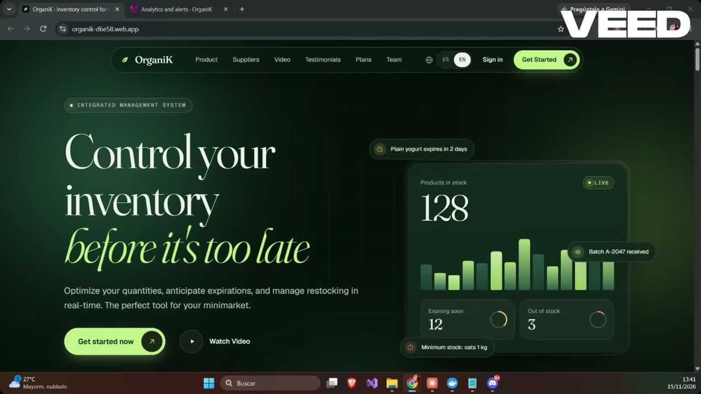
*Figura: Pantalla principal de la Landing Page de OrganiK.*

##### Evidencia 2: Dashboard del administrador (US-030)
El dashboard muestra datos reales del minimarket: unidades en inventario, solicitudes creadas, órdenes por responder, lotes por vencer y stock bajo, calculados por el RESTful API (`GET /api/v1/dashboard`).

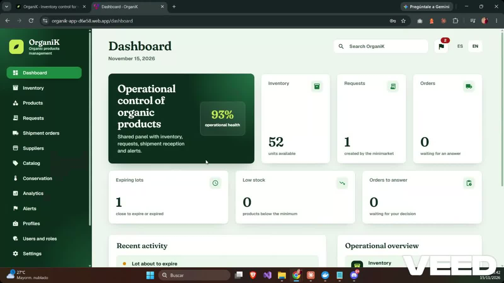
*Figura: Dashboard del administrador de minimarket conectado a los Web Services.*

##### Evidencia 3: Inventario (US-002, US-006, US-008)
Listado de lotes con producto, lote, stock, vencimiento y estado, con acciones para registrar stock, producto, merma y oferta.

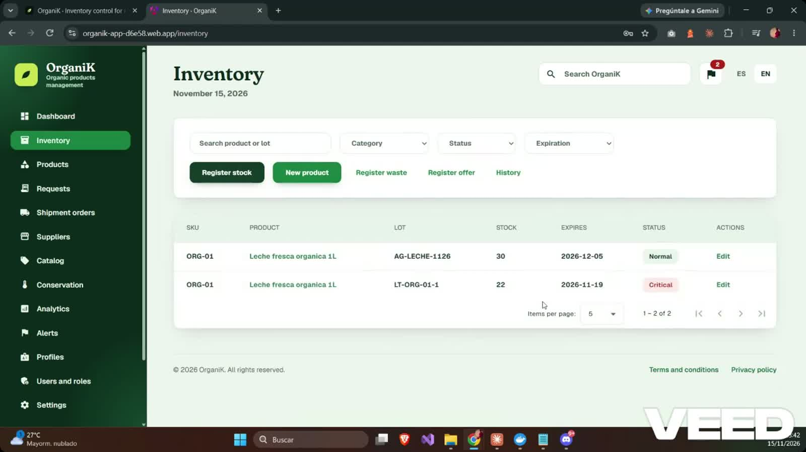
*Figura: Vista de inventario con lotes persistidos.*

##### Evidencia 4: Conservación (US-010, US-011, US-012)
Monitoreo de temperatura y humedad por zona y registro manual de lecturas; una lectura fuera de rango se marca en el historial y genera una alerta.

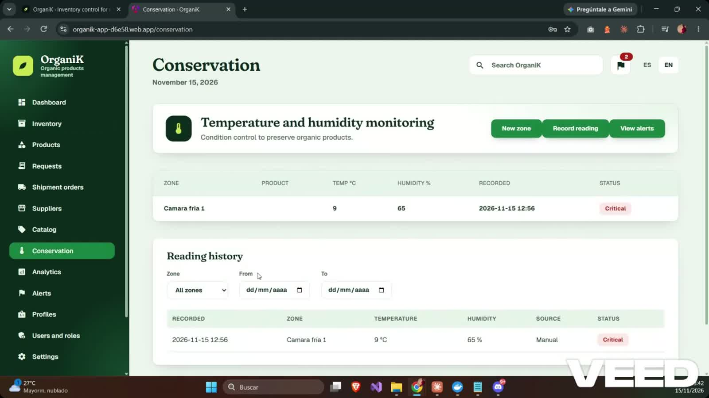
*Figura: Vista de conservación con zonas y lecturas registradas.*

##### Evidencia 5: Analítica y alertas (US-009)
Indicadores operativos (pérdida evitada, productos en riesgo, solicitudes aceptadas), tendencia de alertas y alertas activas.

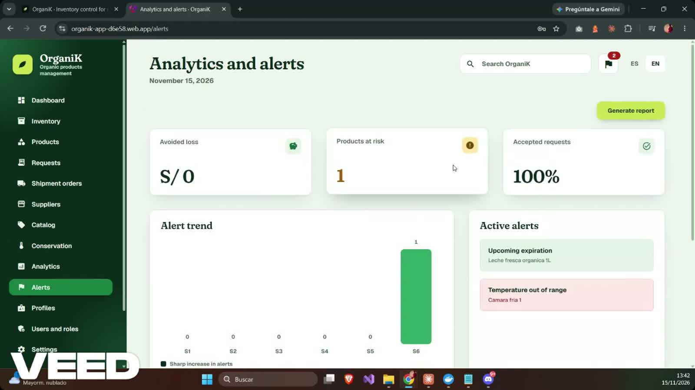
*Figura: Vista de analítica y alertas.*

##### Evidencia 6: Notificaciones
Notificaciones generadas por eventos de integración: orden de envío aceptada y lectura de conservación fuera de rango, con opción para marcarlas como leídas.

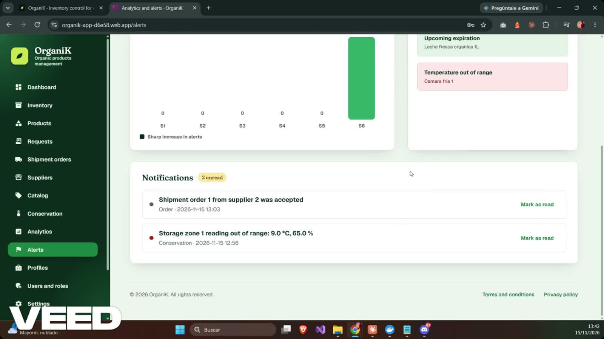
*Figura: Notificaciones del minimarket.*

##### Evidencia 7: Dashboard del proveedor
El proveedor ve las solicitudes compartidas con él, su catálogo y las órdenes que envió.

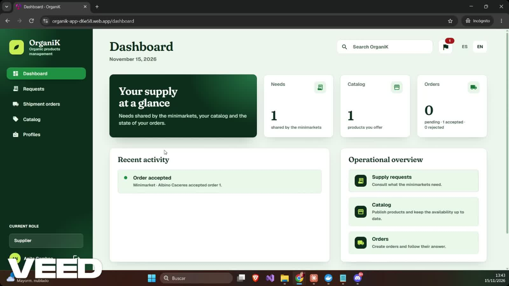
*Figura: Dashboard del proveedor.*

##### Evidencia 8: Solicitudes de abastecimiento (US-018, US-020)
El proveedor consulta las solicitudes de abastecimiento que le envía el minimarket, con producto, cantidad, motivo y estado.

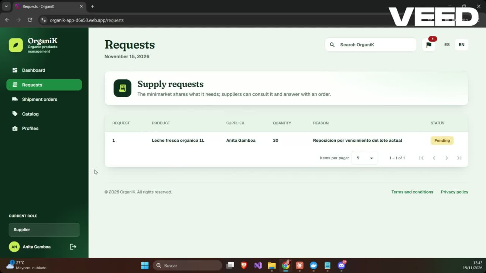
*Figura: Solicitudes de abastecimiento vistas por el proveedor.*

---

#### 5.2.3.6. Services Documentation Evidence for Sprint Review.

En el Sprint 3 se documentaron con OpenAPI (SpringDoc) los 61 endpoints de la primera versión del RESTful API. La documentación se publica con Scalar API Reference, que muestra para cada endpoint su descripción, parámetros, cuerpo de la petición, respuestas posibles con ejemplos y fragmentos de llamada. Todos los endpoints, salvo el registro y el inicio de sesión, requieren un token JWT en la cabecera `Authorization: Bearer <token>`. Los errores siguen RFC 9457 (Problem Details) con un código de error localizado en inglés o español.

* **Repositorio de Web Services:** https://github.com/6Bits-Startup/organik-platform
* **Documentación desplegada (Scalar):** https://organik-platform.onrender.com/scalar
* **Especificación OpenAPI:** https://organik-platform.onrender.com/v3/api-docs
* **Commits relacionados con documentación:** `74efa83` (dependencias de SpringDoc y Scalar), `17838ae` (configuración de Scalar y mensajes localizados).

| Endpoint | Acción | Verbo | Sintaxis de llamada | Parámetros | Respuesta | Technical Story |
| :--- | :--- | :--- | :--- | :--- | :--- | :--- |
| Users | Registrar usuario | POST | `/api/v1/users` | Body: username, password, roles | 201 con el usuario creado; 409 si el usuario existe. | TS-IAM-002 |
| Users | Consultar usuarios | GET | `/api/v1/users` | Query: minimarketId o username | 200 con la lista de usuarios. | TS-IAM-003 |
| Tokens | Iniciar sesión | POST | `/api/v1/tokens` | Body: username, password | 201 con token JWT, id y roles; 401 si las credenciales no son válidas. | TS-IAM-001 |
| Roles | Consultar roles | GET | `/api/v1/roles` | — | 200 con `ROLE_ADMINISTRATOR`, `ROLE_OPERATOR` y `ROLE_SUPPLIER`. | TS-IAM-003 |
| Profiles | Crear, consultar y actualizar perfil | POST, GET, PUT | `/api/v1/profiles`, `/api/v1/profiles/{profileId}`, `/api/v1/profiles/{profileId}/preferences` | Path: profileId; Body: userId, fullName, email, minimarketId; preferencias: language, warningExpirationDays | 201/200 con el perfil; 404 si no existe. | TS-PROF-001 |
| Categories | Crear y consultar categorías | POST, GET | `/api/v1/categories`, `/api/v1/categories/{categoryId}` | Body: name | 201/200 con la categoría. | TS-PROD-001 |
| Products | Crear, consultar y actualizar productos | POST, GET, PUT | `/api/v1/products`, `/api/v1/products/{productId}` | Path: productId; Body: sku, name, categoryId, supplierId, unit | 201/200 con el producto; 400 si faltan datos. | TS-PROD-001, TS-PROD-002 |
| Stock Lots | Registrar, consultar y actualizar lotes | POST, GET, PUT | `/api/v1/stock-lots`, `/api/v1/stock-lots/{stockLotId}` | Query: minimarketId; Body: minimarketId, productId, lotCode, quantity, minimumStock, expirationDate, location; PUT: location, notes, expirationDate | 201/200 con el lote; 404 si no existe. | TS-LOT-001, TS-LOT-002 |
| Inventory Movements | Registrar y consultar movimientos | POST, GET | `/api/v1/inventory-movements`, `/api/v1/inventory-movements/{inventoryMovementId}` | Body: stockLotId, type, quantity | 201 y actualiza la cantidad del lote; 400 si la salida supera el stock. | TS-INV-002, TS-MER-001 |
| Offers | Crear y consultar ofertas | POST, GET | `/api/v1/offers`, `/api/v1/offers/{offerId}` | Body: stockLotId, price, startsOn, endsOn | 201/200 con la oferta. | TS-MER-001 |
| Suppliers | Registrar y consultar proveedores | POST, GET | `/api/v1/suppliers`, `/api/v1/suppliers/{supplierId}` | Body: businessName, contactName, phoneNumber, email | 201/200 con el proveedor. | TS-SUP-001 |
| Offered Products | Publicar, consultar y actualizar productos ofrecidos | POST, GET, PUT | `/api/v1/offered-products`, `/api/v1/offered-products/{offeredProductId}` | Query: supplierId; Body: supplierId, productId, lotCode, availableQuantity | 201/200 con el producto ofrecido. | TS-SUP-002 |
| Supply Requests | Crear, consultar, aceptar y rechazar solicitudes | POST, GET | `/api/v1/supply-requests`, `/{supplyRequestId}`, `/{supplyRequestId}/acceptances`, `/{supplyRequestId}/rejections` | Body: productId, supplierId, minimarketId, quantity, reason, requiredDate | 201/200 con la solicitud y su estado; 409 si ya fue decidida. | TS-ORD-001 |
| Shipment Orders | Crear, consultar, aceptar y rechazar órdenes de envío | POST, GET | `/api/v1/shipment-orders`, `/{shipmentOrderId}`, `/{shipmentOrderId}/acceptances`, `/{shipmentOrderId}/rejections` | Body: supplierId, minimarketId, lines (productId, quantity, lotCode); decisión: decidedBy | 201/200 con la orden; al aceptar se registran los lotes en el inventario. | TS-ORD-002, TS-ORD-003 |
| Storage Zones | Crear y consultar zonas | POST, GET | `/api/v1/storage-zones`, `/api/v1/storage-zones/{storageZoneId}` | Query: minimarketId; Body: minimarketId, name, storageCondition, minTemperature, maxTemperature, minHumidity, maxHumidity | 201/200 con la zona. | TS-CON-001 |
| Storage Readings | Registrar y consultar lecturas | POST, GET | `/api/v1/storage-readings`, `/api/v1/storage-readings/{storageReadingId}` | Body: storageZoneId, temperature, humidity, recordedAt | 201 con la lectura y su estado; fuera de rango crea una notificación. | TS-CON-001, TS-CON-002 |
| Notifications | Crear, consultar y marcar como leída | POST, GET | `/api/v1/notifications`, `/{notificationId}`, `/{notificationId}/readings` | Query: minimarketId | 200 con tipo, título y estado; la lectura la marca como leída. | TS-DASH-002 |
| Dashboard | Consultar resumen operativo | GET | `/api/v1/dashboard` | Query: minimarketId, userId | 200 con unidades, solicitudes, órdenes, lotes por vencer y stock bajo. | TS-DASH-001 |
| Operational Indicators | Consultar indicadores | GET | `/api/v1/operational-indicators` | Query: minimarketId | 200 con pérdida evitada, productos en riesgo y solicitudes aceptadas. | TS-DASH-001 |
| Activity Records | Consultar historial de actividad | GET | `/api/v1/activity-records`, `/api/v1/activity-records/{activityRecordId}` | Query: minimarketId | 200 con actor, acción y fecha de cada operación. | TS-AUD-001 |

Las rutas de la tabla se ajustaron durante la implementación respecto de la propuesta inicial del capítulo III (por ejemplo, `/api/v1/tokens` en lugar de `/api/v1/auth/sign-in` y `/api/v1/stock-lots` en lugar de `/api/v1/lots`), para nombrar los recursos con sustantivos en plural y representar las decisiones (aceptación, rechazo, lectura) como recursos creados con POST.

La siguiente captura muestra la página principal de la documentación desplegada, con los recursos agrupados por etiqueta y la autenticación por token JWT.

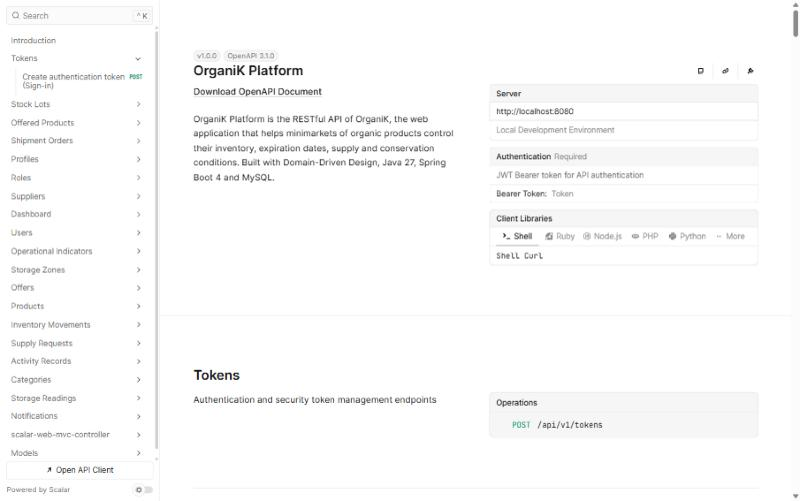
*Figura: Documentación del RESTful API publicada con Scalar.*

La siguiente captura muestra el detalle del endpoint `GET /api/v1/stock-lots/{stockLotId}`, con el parámetro de ruta, las respuestas 200 y 404, el ejemplo de llamada con cURL y el ejemplo de respuesta con datos de muestra (lote `LT-204` de 248 unidades en la cámara fría 1).

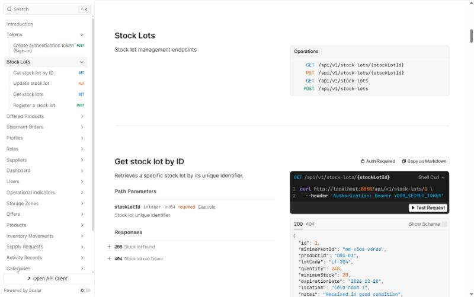
*Figura: Detalle del endpoint de consulta de lotes en Scalar.*

---

#### 5.2.3.7. Software Deployment Evidence for Sprint Review.

En el Sprint 3 se desplegó por primera vez el RESTful API y se publicaron nuevas versiones de la Web Application y de la Landing Page.

**Web Services (Render)**

1. Se agregó al repositorio un `Dockerfile` multi-stage: la primera etapa compila el proyecto con Maven y la segunda ejecuta el JAR sobre una imagen JRE con el perfil `prod`.
2. Se creó en Render un Web Service conectado al repositorio `6Bits-Startup/organik-platform`, que construye la imagen a partir del `Dockerfile` de la rama `main`.
3. Se configuraron en Render las variables de entorno definidas en `.env.example`: `DATABASE_URL`, `DATABASE_PORT`, `DATABASE_NAME`, `DATABASE_USER`, `DATABASE_PASSWORD`, `JWT_SECRET`, `PORT` y `SPRING_PROFILES_ACTIVE=prod`. Las credenciales no se guardan en el repositorio.
4. El perfil `prod` lee la conexión a MySQL desde esas variables y actualiza el esquema al arrancar (`ddl-auto=update`).

* **Repositorio:** https://github.com/6Bits-Startup/organik-platform
* **Entorno local:** http://localhost:8080/scalar
* **URL de producción:** https://organik-platform.onrender.com/scalar

**Web Application (Firebase Hosting)**

La release 2.0.0 apunta la compilación de producción a los Web Services en Render (commit `5712958`) y se publicó con `firebase deploy --only hosting`.

* **Repositorio:** https://github.com/6Bits-Startup/organik-web-application
* **URL de producción:** https://organik-app-d6e58.web.app/

**Landing Page (Firebase Hosting)**

La release 2.2.1 y los videos incrustados se publicaron con `firebase deploy --only hosting`.

* **Repositorio:** https://github.com/6Bits-Startup/organik-website
* **URL de producción:** https://organik-d6e58.web.app/

La siguiente captura muestra el proyecto en Render con el servicio `organik-platform` desplegado en el entorno Production, con runtime Docker y región Virginia.

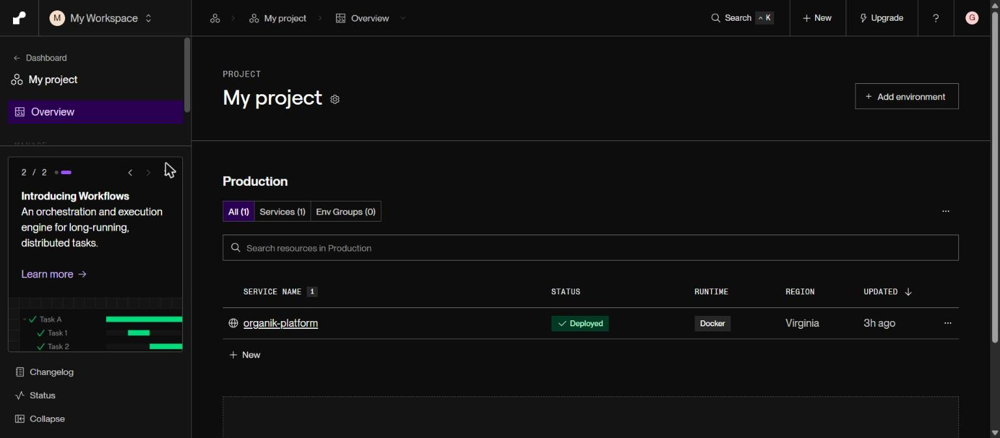
*Figura: Servicio organik-platform desplegado en Render.*

La siguiente captura muestra el detalle del servicio: repositorio `6Bits-Startup/organik-platform` conectado a la rama `main`, URL pública del servicio y los despliegues realizados a partir de los pull requests #6 y #7 de la release 1.0.0. Las variables de entorno no se muestran porque contienen credenciales.

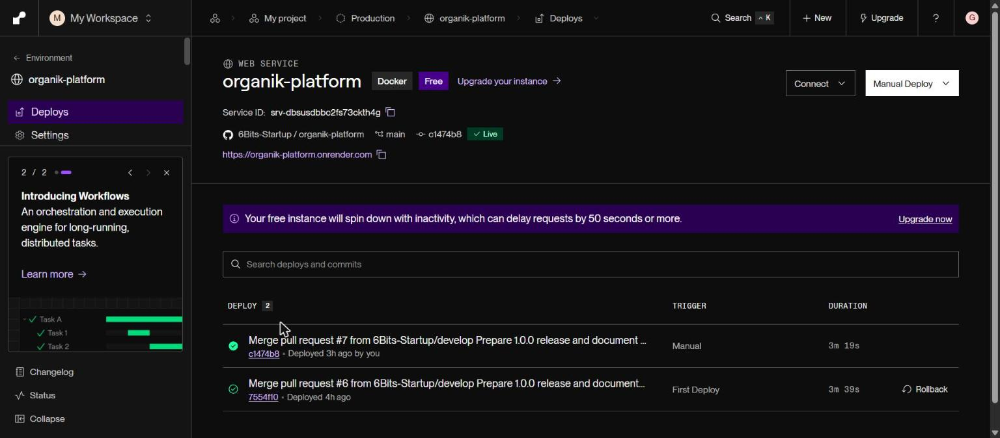
*Figura: Historial de despliegues del RESTful API en Render.*

---

#### 5.2.3.8. Team Collaboration Insights during Sprint.

En el Sprint 3 todos los integrantes registraron commits en el repositorio de los Web Services. Cada integrante lideró un bounded context y lo implementó en ramas <code>feature</code> por capa o por recurso, con commits que siguen Conventional Commits; las ramas se integraron en <code>develop</code> y se publicaron en <code>main</code> con la release 1.0.0. El equipo coordinó el trabajo en sesiones de Discord y en el tablero de Jira.

La siguiente tabla resume los commits registrados por integrante entre el 25/10/2026 y el 15/11/2026 (sin merges, todas las ramas), obtenidos con <code>git log --all --no-merges</code> de cada repositorio.

<table border="1" cellpadding="4" cellspacing="0" align="center">
  <thead>
    <tr>
      <th>Team Member</th>
      <th>GitHub Username</th>
      <th>Web Services</th>
      <th>Web Application</th>
      <th>Landing Page</th>
      <th>Total</th>
    </tr>
  </thead>
  <tbody>
    <tr><td>Atencio Cristobal, Cielo Valentina</td><td>Ciel0p</td><td>54</td><td>7</td><td>0</td><td>61</td></tr>
    <tr><td>Cáceres Pizarro, Albino Florencio</td><td>Lil Doggy / a.caceres</td><td>58</td><td>0</td><td>0</td><td>58</td></tr>
    <tr><td>Olivares Lao, Gustavo Alonso</td><td>GeGuMaGu25</td><td>50</td><td>36</td><td>3</td><td>89</td></tr>
    <tr><td>Quispe Almonacid, Andre Sebastian</td><td>u201815005 / Seb2920 / Sebastian</td><td>39</td><td>0</td><td>0</td><td>39</td></tr>
    <tr><td>Torres Huaman, Alexis Calin</td><td>Alexis Calin Torres Huaman</td><td>90</td><td>0</td><td>0</td><td>90</td></tr>
  </tbody>
</table>

  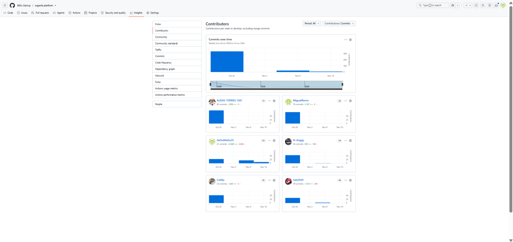
  
<em>Figura: Contribuidores del repositorio de los Web Services (GitHub Insights).</em>

  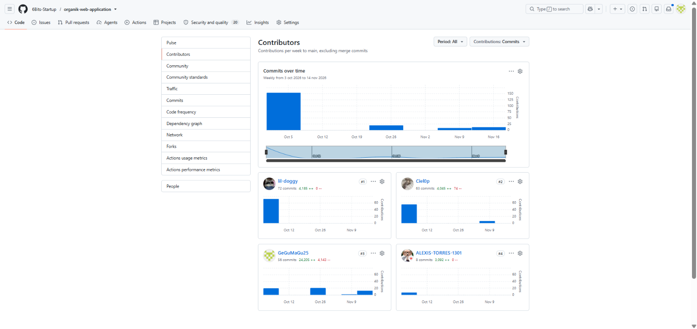
  
<em>Figura: Contribuidores del repositorio de la Web Application (GitHub Insights).</em>

  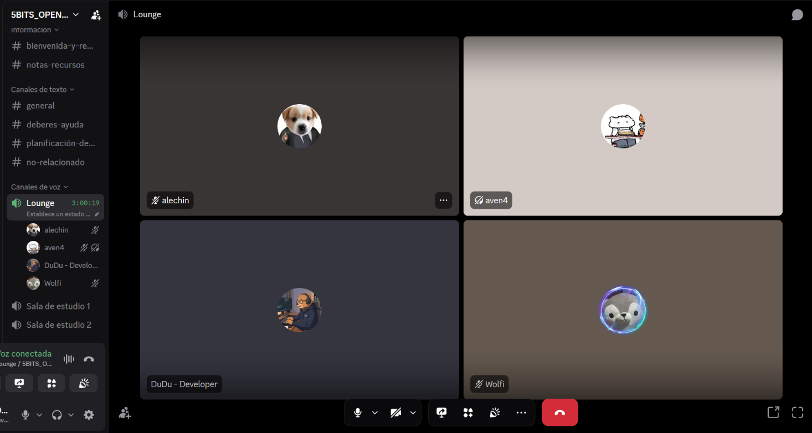
  
<em>Figura: Sesión de trabajo del equipo en Discord durante el Sprint 3.</em>

En los Web Services, el trabajo se distribuyó por bounded context: Products (Atencio), Procurements (Cáceres), base del API, IAM, Dashboard, Analytics y despliegue (Olivares), Conservation, Communication y Profiles (Quispe) y Suppliers y Requisition (Torres); Olivares lideró además Inventory. En la Web Application, Atencio implementó las clases base de la capa de infraestructura y Olivares realizó la integración con los Web Services. En la Landing Page, Olivares incrustó los videos.

---

## 5.3. Validation Interviews.

### 5.3.1. Diseño de Entrevistas.

Las entrevistas de validación con usuarios de los segmentos objetivo no se realizaron durante el Sprint 3. El equipo priorizó la implementación y el despliegue de los Web Services, de los que dependen los flujos que se validarán. Las sesiones de validación con administradores de minimarket y proveedores se programan para el Sprint 4, sobre la versión desplegada de la Landing Page y de la Web Application, con los siguientes user flows:

* **Administrador de minimarket:** iniciar sesión, registrar stock de un lote, atender una alerta de conservación y aceptar o rechazar una orden de envío.
* **Proveedor:** iniciar sesión, publicar un producto ofrecido y responder una solicitud de abastecimiento con una orden de envío.
* **Visitante:** identificar la propuesta de valor, revisar los planes de su segmento y llegar al registro de la Web Application desde la Landing Page.

### 5.3.2. Registro de Entrevistas.

Pendiente para el Sprint 4.

### 5.3.3. Evaluaciones según heurísticas.

Pendiente para el Sprint 4.

---

## 5.4. Video About-the-Product.

El video About the Product está dirigido a los visitantes de la Landing Page que quieren conocer el modelo de negocio de **OrganiK** y a los usuarios de la Web Application que quieren ver cómo realizar sus tareas. En un tono cercano y directo, coherente con el producto, el video presenta la propuesta de valor (controlar el inventario de productos orgánicos antes de que sea tarde), las funciones principales (inventario, lotes, vencimientos, conservación y alertas), los testimonios y los planes por segmento, y recorre la Web Application con el flujo del administrador de minimarket (dashboard, inventario, conservación, analítica y notificaciones) y el del proveedor (dashboard y solicitudes de abastecimiento).

Esta primera versión no incluye todavía un testimonio de un usuario de las entrevistas de validación, porque estas se realizarán en el Sprint 4; se agregará en la versión final del video.

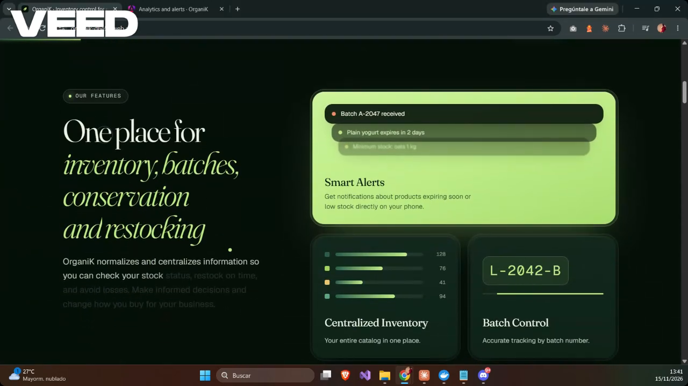
*Figura: Cuadro del video About the Product.*

| Dato | Valor |
| :--- | :--- |
| Duración | 2:00 |
| YouTube (incrustado en la Landing Page) | https://www.youtube.com/watch?v=2eTcuGm2veU |
| Microsoft Stream | [Ver video en Microsoft Stream](https://upcedupe-my.sharepoint.com/:v:/g/personal/u202216448_upc_edu_pe/IQDgQed5MQpFSZ0xDI7D5hVkAbGvUVGdb0lKAjQWWSYiGmo?e=ZtXDh0) |
| Archivo | upc-pre-202620-1asi0729-7742-5Bits-about-the-product-sprint-3.mp4 |
